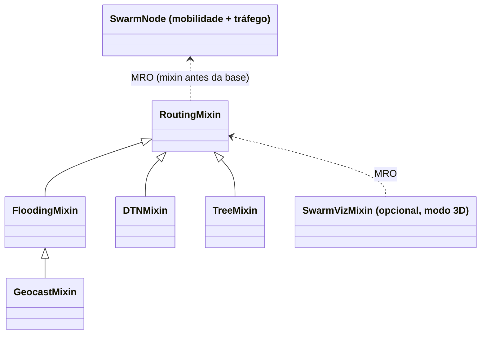

# Relatório Técnico: Roteamento em FANET sobre a Topologia Swarm Core em V

**Disciplina:** INF2541 / INF20451 – Introdução à Computação Móvel e Ubíqua (PUC-Rio)
**Projeto de Pesquisa:** GrADyS (*Ground-with-Air Dynamic Networked Systems*)
**Docente:** Prof. Markus Endler
**Simulador:** GrADySim NextGen 0.8.0

---

## 1. Visão geral

O projeto compara quatro protocolos de roteamento numa mesma topologia de drones (FANET): o **Swarm Core em formação V**. A topologia tem uma torre terrestre, um núcleo de 9 drones em V girando em torno da torre e 4 satélites periféricos. Só o protocolo muda entre as execuções:

1. **Flooding**: inundação com supressão de duplicatas e TTL.
2. **GeoCast**: flooding restrito a uma zona de encaminhamento geográfica.
3. **DTN**: Store-Carry-Forward com transferência de custódia.
4. **Árvore Geradora**: roteamento por unicast sobre a árvore da formação (protocolo do Swarm Core).

Todas as métricas são medidas durante a simulação. Nenhum valor é fixado no código.

## 2. Arquitetura

O código segue o padrão de extensão do template `t2-template`:
- cada protocolo é um *mixin* colocado antes da classe base do nó;
- uma *factory* monta a classe;
- todos os parâmetros ficam num único `config.py`;
- a visualização é um mixin separado.

A classe base de movimento do template (patrulha por waypoints com sensores) não modela uma formação em V girando. Por isso a base aqui é própria: `SwarmNode`.

```text
proj_gradys/
├── main.py                     # menu interativo (protocolo → modo 3D ou headless)
└── src/
    ├── config.py               # parâmetros do cenário e dos protocolos
    ├── scenario.py             # papéis, geometria do V, órbitas e agenda de tráfego
    ├── node.py                 # SwarmNode: mobilidade + agenda de tráfego (sem roteamento)
    ├── nodes.py                # factory make_node(protocolo, viz)
    ├── metrics.py              # métricas medidas (RoutingMetrics)
    ├── viz.py                  # cores, HUD e log de eventos (modo 3D)
    ├── main.py                 # orquestração, benchmark e tabela
    └── routing/
        ├── base.py             # RoutingMixin: criação, envio, entrega, vizinhança
        ├── messages.py         # esquemas das mensagens
        ├── flooding_mixin.py
        ├── geocast_mixin.py
        ├── dtn_mixin.py
        └── tree_mixin.py
```



**Separação importante:** a *mobilidade* é roteiro do cenário (formação, ronda, órbitas, tandem) e usa o relógio da simulação. O *roteamento* nunca usa o relógio para escolher caminhos: decide só com base em vizinhos ouvidos (beacons), posições e tabelas locais.

## 3. Cenário (idêntico para os quatro protocolos)

| Elemento | Valor |
| :--- | :--- |
| Torre terrestre (nó 0) | fixa em `(25, 0, 5)`, centro de rotação |
| Core em V (nós 1–9) | C1 é o ápice. Asa esquerda C2–C5 (externa) e asa direita C6–C9 (interna), com Δu = 2 m e Δv = 5,5 m (abertura ≈ 40°). Altitude 15 m |
| Rotação | ω = 2π/22 ≈ 0,2856 rad/s (uma volta em 22 s); C1 a 34 m da torre; velocidade máxima 14 m/s |
| Revezamento (FF Control) | C4 sai para ronda externa em t = 12 s, C5 cobre o slot de C4 em t = 12,5 s, C4 volta e intercepta o próprio slot em t = 22 s |
| Satélites (nós 10–13) | órbita de raio 48 m a 0,10 rad/s, altitude 17,5 m. Tandem: S1 acompanha C5 até t = 7,5 s; S3 acopla em C9 de t = 10 s a t = 12,5 s |
| Rádio | alcance 40 m, atraso 0,01 s, sem perdas aleatórias |
| Duração | 40 s (≈ 1,8 volta da formação) |

**Tráfego (igual em todos os protocolos):**
- Missão encadeada do Swarm Core original: Torre → S1 (t = 2 s), S1 → S2 (6 s), S3 → S2 (10,5 s), S2 → S4 (14,6 s) e S4 → Torre (23 s, relatório).
- Telemetria periódica: cada satélite envia para a torre a cada 4 s, entre 3 s e 28 s.
- Total: 31 mensagens.

### 3.1 Escolha do alcance de rádio

Com o alcance de **50 m** da versão anterior, a torre alcança diretamente todos os 13 nós (o mais distante, um satélite, está a 49,6 m). A rede vira um único salto e os protocolos ficam indistinguíveis. PDR medido por alcance:

| Alcance | Flooding | GeoCast | DTN | Árvore | Saltos médios (Flooding) |
| :---: | :---: | :---: | :---: | :---: | :---: |
| 30 m | 9,7% | 9,7% | 48,4% | 12,9% | 1,67 |
| 35 m | 64,5% | 61,3% | 54,8% | 25,8% | 2,20 |
| **40 m** | **64,5%** | **61,3%** | **93,5%** | **83,9%** | **2,00** |
| 45 m | 71,0% | 64,5% | 96,8% | 90,3% | 2,00 |
| 50 m | 100% | 100% | 100% | 100% | 1,03 |

Com **40 m**, a torre só alcança C1, C2 e a asa direita, e os satélites só têm contato com o Core em parte da órbita. A rede é multi-salto e intermitente, que é a condição em que faz sentido comparar os protocolos.

## 4. Protocolos

### 4.1 Flooding (`flooding_mixin.py`)
- A origem transmite em broadcast com `TTL = 8`. Cada nó retransmite no máximo uma vez (tabela de mensagens vistas).
- O destino entrega e não retransmite.
- Não há armazenamento: sem caminho no instante da inundação, a mensagem se perde.

### 4.2 GeoCast (`geocast_mixin.py`)
- A mensagem leva a posição da origem e a **zona de entrega** (círculo de 15 m em torno da posição do destino na criação).
- A **zona de encaminhamento** é o menor retângulo (plano XY) que contém a origem e a zona de entrega, ampliado em 15 m (no estilo do esquema 1 do LAR, de Ko & Vaidya).
- O nó só retransmite se a sua posição atual estiver dentro da zona. Caso contrário, poda a mensagem.

### 4.3 DTN com custódia (`dtn_mixin.py`)
- A mensagem é guardada no buffer e o nó a carrega enquanto se move.
- A cada beacon recebido, para cada mensagem: se o destino é vizinho, envia direto a ele. Senão, entrega ao vizinho que esteja pelo menos 5 m mais perto da posição do destino. As mensagens que vão para o mesmo vizinho seguem num só lote, por unicast.
- O remetente só apaga a mensagem após o ACK de custódia. Sem ACK em 2 s, ela volta a ser elegível para envio.

### 4.4 Árvore Geradora (`tree_mixin.py`)
- **Árvore da formação:** Torre → C1 → C2 → C3 → C4 → C5 e C1 → C6 → C7 → C8 → C9.
- **Detecção de enlace:** se o pai não é ouvido há 2,5 s, o nó se liga ao ancestral vivo mais próximo. Por exemplo, durante a ronda de C4, C5 passa a usar C3. Na versão anterior, essa troca era feita por horário (`12,5 ≤ t < 22`); agora ela decorre da perda de beacons.
- **Satélites** injetam suas mensagens no nó do Core mais próximo que estão ouvindo.
- **Mensagens para a torre** sobem pela árvore.
- **Mensagens para satélites** se espalham pela árvore por unicast, uma cópia por nó e sem broadcast. Quem ouvir o satélite entrega; cada cópia expira em 15 s.
- **Sem confirmação de entrega**, como no Swarm Core original.

## 5. Métricas (`src/metrics.py`)

| Métrica | Definição |
| :--- | :--- |
| PDR | mensagens que chegaram ao destino / mensagens criadas |
| Missão | quantas das 5 mensagens da missão encadeada chegaram |
| Latência | instante da entrega − instante de criação (relógio global da simulação) |
| Saltos | transmissões de rádio percorridas pela cópia entregue |
| Tx dados | todo envio que carrega mensagens de roteamento, incluindo o da origem |
| Tx controle | beacons (DTN e Árvore) e ACKs de custódia (DTN) |
| Recep. redund. | um nó recebe uma mensagem que já tinha visto |
| Entregas dupl. | o destino recebe de novo uma mensagem já entregue |
| Cópias expiradas | cópias guardadas na árvore que expiraram sem entrega |

## 6. Resultados

Comando: `python main.py 5`. A simulação é determinística: não há aleatoriedade no cenário.

| Protocolo | Criadas | Entregues | PDR % | Missão | Lat. média s | Lat. mediana s | Saltos médios | Tx dados | Tx controle | Tx / entrega | Recep. redund. | Entregas dupl. | Podas zona | Cópias expiradas |
| :---: | :---: | :---: | :---: | :---: | :---: | :---: | :---: | :---: | :---: | :---: | :---: | :---: | :---: | :---: |
| Flooding | 31 | 20 | 64.5 | 5/5 | 0.02 | 0.02 | 2.00 | 271 | 0 | 13.55 | 1919 | 112 | 0 | 0 |
| GeoCast | 31 | 19 | 61.3 | 5/5 | 0.02 | 0.02 | 1.95 | 190 | 0 | 10.00 | 1396 | 90 | 64 | 0 |
| DTN | 31 | 29 | 93.5 | 4/5 | 5.37 | 0.02 | 1.93 | 46 | 600 | 22.28 | 0 | 0 | 0 | 0 |
| Árvore | 31 | 26 | 83.9 | 5/5 | 3.14 | 0.03 | 2.12 | 66 | 560 | 24.08 | 0 | 3 | 0 | 1 |

Transmissões de dados por entrega: Flooding 13,6; GeoCast 10,0; **DTN 1,6**; **Árvore 2,5**.

## 7. Discussão

1. **Armazenar é o que mais aumenta a entrega.** Flooding e GeoCast só entregam quando existe caminho completo no instante do envio (≈ 62–65%). O DTN guarda e carrega a mensagem até haver contato e chega a 93,5%. A árvore guarda mensagens enquanto não há próximo salto e chega a 83,9%. O custo é a latência: em média 5,4 s no DTN e 3,1 s na árvore, embora a mediana seja quase instantânea nos dois.
2. **Flooding desperdiça muito.** Foram 1919 recepções redundantes e 112 entregas duplicadas para 20 entregas. O GeoCast poda 64 retransmissões fora da zona e reduz as transmissões de dados em 30% (271 → 190), ao custo de uma entrega a menos.
3. **Unicast dirigido é eficiente nos dados, mas paga em controle.** DTN e árvore usam 1,6 e 2,5 transmissões de dados por entrega, contra 13,6 do Flooding. Por outro lado, os beacons (14 nós × 1 Hz × 40 s ≈ 560) dominam o tráfego total. Com tão poucas mensagens (31), o custo total por entrega acaba maior que o do Flooding. Com mais tráfego, ou com beacons menos frequentes, esse custo se dilui.
4. **A árvore não tem confirmação.** As 5 mensagens que ela perdeu não estavam em nenhum buffer no fim da simulação: perderam-se em trânsito, quando o enlace caiu entre o último beacon e o envio. O DTN evita isso com o ACK de custódia; as 2 mensagens que ele não entregou ficaram no buffer de S4, que ficou sem contato até o fim.
5. **A adaptação ao revezamento vem da detecção de enlace.** C4 sai em t = 12 s, mas continua ao alcance de C5 por mais alguns segundos. C5 só passa a usar C3 como pai em t ≈ 16 s, quando os beacons de C4 deixam de chegar, e volta a C4 em t ≈ 23 s, depois da reentrada. Esse atraso é o preço de detectar a mudança pela rede em vez de usar um horário fixo (HUD "Pai na árvore").

## 8. Premissas e limitações

- **Serviço de localização:** ao criar uma mensagem, a origem conhece a posição do destino naquele instante. Essa é a premissa clássica do GeoCast e também é usada pelo DTN. Como os satélites se movem, essa posição fica desatualizada com o tempo.
- **Zona do GeoCast em 2D:** a altitude é ignorada.
- **Amostra pequena** (31 mensagens, uma execução determinística): os números mostram tendências, não diferenças estatisticamente testadas.
- **Latência** medida com o relógio global da simulação; um sistema real exigiria relógios sincronizados (ex.: GPS).
- **Mobilidade roteirizada pelo relógio.** A formação é uma estrutura virtual: cada drone calcula o próprio slot a partir do tempo, sem ler a posição do líder.

## 9. Visualização (modo 3D)

| Cor | Significado |
| :---: | :--- |
| Azul royal | Torre terrestre |
| Roxo | Líder C1 |
| Branco | Asas do V |
| Turquesa | C5 cobrindo a vaga de C4 |
| Laranja | C4 em ronda externa |
| Amarelo | Satélites |
| Marrom-claro | Carregando mensagens (DTN / Árvore) |
| Magenta | Criou mensagem |
| Ciano | Retransmitiu / repassou |
| Branco | Custódia confirmada (DTN) |
| Grafite | Podou (GeoCast) |
| Vermelho | Descartou por TTL |
| Verde | Recebeu uma mensagem destinada a ele |

Ao clicar num nó, o HUD mostra papel, protocolo, estado de voo, pai na árvore (protocolo 4), contadores e o último evento. Os eventos também são impressos no terminal (`EVENT_LOG` em `src/config.py`).

## 10. Execução

```powershell
python -m venv gradys-env
.\gradys-env\Scripts\activate
pip install -r requirements.txt

python main.py          # menu interativo (protocolo → modo 3D ou headless)
python main.py 4 1      # atalho: Árvore Geradora no visualizador 3D
python main.py 3 2      # atalho: DTN headless
python main.py 5        # atalho: benchmark (tabela da Seção 6)
```

Opções do menu: 1 Flooding, 2 GeoCast, 3 DTN, 4 Árvore Geradora, 5 Benchmark.
