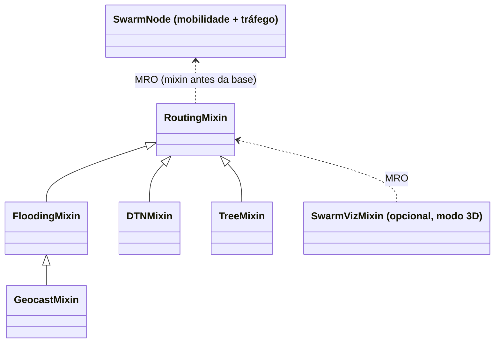

# Relatório Técnico: Roteamento em FANET sobre a Topologia Swarm Core em V

**Disciplina:** INF2541 / INF20451 – Introdução à Computação Móvel e Ubíqua (PUC-Rio)
**Projeto de Pesquisa:** GrADyS (*Ground-with-Air Dynamic Networked Systems*)
**Docente:** Prof. Markus Endler
**Simulador:** GrADySim NextGen 0.8.0

---

## 1. Visão geral

O projeto compara quatro protocolos de roteamento numa mesma topologia de drones (FANET): o **Swarm Core em formação V**. A topologia tem uma torre terrestre, um núcleo de 9 drones em V girando em torno da torre e 4 satélites periféricos. Só o protocolo muda entre as execuções:

1. **Flooding**: inundação com supressão de duplicatas e TTL.
2. **GeoCast**: flooding restrito a uma zona de encaminhamento geográfica.
3. **DTN**: Store-Carry-Forward com transferência de custódia.
4. **Árvore Geradora**: roteamento por unicast sobre a árvore da formação (protocolo do Swarm Core).

Todas as métricas são medidas durante a simulação. Nenhum valor é fixado no código.

## 2. Arquitetura

O código segue o padrão de extensão do template `t2-template`:
- cada protocolo é um *mixin* colocado antes da classe base do nó;
- uma *factory* monta a classe;
- todos os parâmetros ficam num único `config.py`;
- a visualização é um mixin separado.

A classe base de movimento do template (patrulha por waypoints com sensores) não modela uma formação em V girando. Por isso a base aqui é própria: `SwarmNode`.

```text
proj_gradys/
├── main.py                     # menu interativo (protocolo → modo 3D ou headless)
└── src/
    ├── config.py               # parâmetros do cenário e dos protocolos
    ├── scenario.py             # papéis, geometria do V, órbitas e agenda de tráfego
    ├── node.py                 # SwarmNode: mobilidade + agenda de tráfego (sem roteamento)
    ├── nodes.py                # factory make_node(protocolo, viz)
    ├── metrics.py              # métricas medidas (RoutingMetrics)
    ├── viz.py                  # cores, HUD e log de eventos (modo 3D)
    ├── motor.py                # monta e roda a simulação; tabela no terminal e em results.md
    └── routing/
        ├── base.py             # RoutingMixin: criação, envio, entrega, vizinhança
        ├── messages.py         # esquemas das mensagens
        ├── flooding_mixin.py
        ├── geocast_mixin.py
        ├── dtn_mixin.py
        └── tree_mixin.py
```



**Separação importante:** a *mobilidade* é roteiro do cenário (formação, ronda, órbitas, tandem) e usa o relógio da simulação. O *roteamento* nunca usa o relógio para escolher caminhos: decide só com base em vizinhos ouvidos (beacons), posições e tabelas locais.

## 3. Cenário (idêntico para os quatro protocolos)

| Elemento | Valor |
| :--- | :--- |
| Torre terrestre (nó 0) | fixa em `(25, 0, 5)`, centro de rotação |
| Core em V (nós 1–9) | C1 é o ápice. Asa esquerda C2–C5 (externa) e asa direita C6–C9 (interna), com Δu = 2 m e Δv = 5,5 m (abertura ≈ 40°). Altitude 15 m |
| Rotação | ω = 2π/60 ≈ 0,105 rad/s (uma volta em 60 s, "slowly revolves"); C1 a 34 m da torre |
| Revezamento (FF Control) | C4 sai para ronda externa em t = 12 s, C5 cobre o slot de C4 em t = 12,5 s, C4 volta e intercepta o próprio slot em t = 22 s |
| Satélites (nós 10–13) | órbita de raio 48 m a −0,06 rad/s (sentido **contrário** ao do Core), altitude 17,5 m |
| Tandem | cada satélite tem 2 janelas de 10 s ao longo da simulação. No início da janela, ele acopla no nó do Core mais próximo e o acompanha até o fim (C4 fica de fora até voltar da ronda) |
| Rádio | alcance 40 m, atraso 0,01 s, sem perdas aleatórias |
| Duração | 180 s (3 voltas da formação) |

**Por que os satélites giram no sentido contrário.** Com o Core a 0,105 rad/s, satélites no mesmo sentido e com velocidade parecida quase não mudariam de posição em relação à formação: num teste com 0,10 rad/s, o PDR do Flooding caiu para 21%. No sentido contrário, a velocidade relativa é de 0,165 rad/s, e cada satélite reencontra o Core a cada ≈ 38 s.

**Tráfego (igual em todos os protocolos):**
- **Aleatório entre satélites**, como pede o enunciado ("S1..S4 randomly send messages to another dispersed node"): cada satélite envia mensagens entre 3 s e 165 s, com intervalo sorteado entre 2 s e 6 s, a outro satélite também sorteado.
- O sorteio usa uma **semente fixa** (`TRAFFIC_SEED = 42`), então os quatro protocolos recebem exatamente as mesmas mensagens, nos mesmos instantes.
- **Missão encadeada** do Swarm Core original, mantida como fluxo de referência: Torre → S1 (t = 2 s), S1 → S2 (6 s), S3 → S2 (10,5 s), S2 → S4 (14,6 s) e S4 → Torre (23 s, relatório).
- Total: 164 mensagens (159 aleatórias e 5 da missão).

### 3.1 Escolha do alcance de rádio

Com o alcance de **50 m** da versão anterior, a torre alcança diretamente todos os 13 nós (o mais distante, um satélite, está a 49,6 m). A rede vira praticamente um único salto e os protocolos ficam quase indistinguíveis. PDR medido por alcance:

| Alcance | Flooding | GeoCast | DTN | Árvore | Saltos médios (Flooding) |
| :---: | :---: | :---: | :---: | :---: | :---: |
| 30 m | 32,9% | 32,9% | 85,4% | 73,8% | 1,41 |
| 35 m | 37,8% | 37,8% | 89,0% | 79,9% | 1,42 |
| **40 m** | **43,9%** | **43,9%** | **89,6%** | **83,5%** | **1,46** |
| 45 m | 48,2% | 48,2% | 92,1% | 83,5% | 1,48 |
| 50 m | 100% | 93,3% | 100% | 94,5% | 1,62 |

Com **40 m**, a torre só alcança parte do Core, e os satélites só têm contato com o Core em parte da órbita. A rede é multi-salto e intermitente, que é a condição em que faz sentido comparar os protocolos. A ordem entre os protocolos é a mesma de 30 m a 45 m, então a conclusão não depende de um ajuste fino do alcance.

## 4. Protocolos

### 4.1 Flooding (`flooding_mixin.py`)
- A origem transmite em broadcast com `TTL = 8`. Cada nó retransmite no máximo uma vez (tabela de mensagens vistas).
- O destino entrega e não retransmite.
- Não há armazenamento: sem caminho no instante da inundação, a mensagem se perde.

### 4.2 GeoCast (`geocast_mixin.py`)
- A mensagem leva a posição da origem e a **zona de entrega** (círculo de 15 m em torno da posição do destino na criação).
- A **zona de encaminhamento** é o menor retângulo (plano XY) que contém a origem e a zona de entrega, ampliado em 15 m (no estilo do esquema 1 do LAR, de Ko & Vaidya).
- O nó só retransmite se a sua posição atual estiver dentro da zona. Caso contrário, poda a mensagem.

### 4.3 DTN com custódia (`dtn_mixin.py`)
- A mensagem é guardada no buffer e o nó a carrega enquanto se move.
- A cada beacon recebido, para cada mensagem: se o destino é vizinho, envia direto a ele. Senão, entrega ao vizinho que esteja pelo menos 5 m mais perto da posição do destino. As mensagens que vão para o mesmo vizinho seguem num só lote, por unicast.
- O remetente só apaga a mensagem após o ACK de custódia. Sem ACK em 2 s, ela volta a ser elegível para envio.

### 4.4 Árvore Geradora (`tree_mixin.py`)
- **Árvore da formação:** Torre → C1 → C2 → C3 → C4 → C5 e C1 → C6 → C7 → C8 → C9.
- **Detecção de enlace:** se o pai não é ouvido há 2,5 s, o nó se liga ao ancestral vivo mais próximo (por exemplo, C5 passaria a usar C3 se perdesse C4). Na versão anterior, essa troca era feita por horário (`12,5 ≤ t < 22`); agora ela decorre da perda de beacons.
- **Satélites** injetam suas mensagens no nó do Core mais próximo que estão ouvindo.
- **Mensagens para a torre** sobem pela árvore.
- **Mensagens para satélites** seguem por unicast, pelo caminho da árvore, até o **nó-alvo**: o nó do Core cuja vaga na formação está mais perto da posição do satélite na criação (`TREE_TARGETS = 1`). O alvo guarda a cópia por até 40 s (≈ um período de encontro com o satélite) e a entrega quando ouvir o satélite. Qualquer nó do caminho que já ouça o satélite entrega direto.
- A posição de cada nó do Core vem do slot da formação, que todos conhecem (estrutura virtual, Seção 8). Por isso o nó de entrada consegue escolher o alvo sem consultar os outros.
- **Sem confirmação de entrega**, como no Swarm Core original.

## 5. Métricas (`src/metrics.py`)

| Métrica | Definição |
| :--- | :--- |
| PDR | mensagens que chegaram ao destino / mensagens criadas |
| Missão | quantas das 5 mensagens da missão encadeada chegaram |
| Latência | instante da entrega − instante de criação (relógio global da simulação) |
| Saltos | transmissões de rádio percorridas pela cópia entregue |
| Tx dados | todo envio que carrega mensagens de roteamento, incluindo o da origem |
| Tx controle | beacons (DTN e Árvore) e ACKs de custódia (DTN) |
| Recep. redund. | um nó recebe uma mensagem que já tinha visto |
| Entregas dupl. | o destino recebe de novo uma mensagem já entregue |
| Cópias expiradas | cópias guardadas na árvore que expiraram sem entrega |

## 6. Resultados

Comando: `python main.py 5`. A tabela também é gravada em `results.md`, na raiz do projeto. Com a semente fixa, cada execução produz exatamente os mesmos números.

| Protocolo | Criadas | Entregues | PDR % | Missão | Lat. média s | Lat. mediana s | Saltos médios | Tx dados | Tx controle | Tx / entrega | Recep. redund. | Entregas dupl. | Podas zona | Cópias expiradas |
| :---: | :---: | :---: | :---: | :---: | :---: | :---: | :---: | :---: | :---: | :---: | :---: | :---: | :---: | :---: |
| Flooding | 164 | 72 | 43.9 | 5/5 | 0.01 | 0.01 | 1.46 | 1198 | 0 | 16.64 | 9242 | 298 | 0 | 0 |
| GeoCast | 164 | 72 | 43.9 | 5/5 | 0.01 | 0.01 | 1.46 | 888 | 0 | 12.33 | 6617 | 277 | 211 | 0 |
| DTN | 164 | 147 | 89.6 | 5/5 | 11.58 | 3.06 | 2.67 | 364 | 2850 | 21.86 | 0 | 0 | 0 | 0 |
| Árvore | 164 | 137 | 83.5 | 5/5 | 7.87 | 2.15 | 3.15 | 525 | 2520 | 22.23 | 0 | 0 | 0 | 0 |

Nenhuma mensagem foi descartada por TTL. Transmissões de dados por entrega: Flooding 16,6; GeoCast 12,3; **DTN 2,5**; Árvore 3,8.

**Resumo por critério:**

| Critério | Melhor | Árvore (Swarm Core) |
| :--- | :--- | :--- |
| Taxa de entrega (PDR) | DTN (89,6%) | 2º lugar (83,5%), bem acima de Flooding e GeoCast (43,9%) |
| Latência mediana | Flooding e GeoCast (0,01 s), mas só entregam o que tem caminho imediato | 2,15 s, contra 3,06 s do DTN |
| Transmissões de dados | DTN (364) | 2º lugar (525) |
| Custo total por entrega | Flooding (16,6), por não ter beacons | 22,2, quase igual ao DTN (21,9) |
| Missão encadeada | Empate (5/5 em todos) | 5/5 |

## 7. Discussão

1. **Armazenar é o que mais aumenta a entrega.** Flooding e GeoCast só entregam quando existe um caminho completo no instante do envio. Como os satélites só encontram o Core a cada ≈ 38 s, isso acontece em menos da metade dos envios (43,9%). O DTN guarda e carrega a mensagem até o próximo contato e chega a 89,6%. A árvore guarda a cópia no nó-alvo por até 40 s e chega a 83,5%. O preço é a latência: média de 11,6 s no DTN e 7,9 s na árvore.
2. **A hipótese de que a árvore do Swarm Core seria a melhor se confirma só em parte.** Ela supera com folga as soluções sem armazenamento (83,5% contra 43,9%) e entrega mais rápido que o DTN (mediana de 2,15 s contra 3,06 s), porque usa a árvore já formada em vez de esperar o portador certo. Mas fica atrás do DTN em taxa de entrega (89,6%) e em transmissões de dados (525 contra 364).
3. **Mirar no satélite é melhor do que espalhar pela árvore.** A primeira versão espalhava cada mensagem para um satélite pela árvore inteira, e todos os nós guardavam uma cópia por 15 s (PDR de 78,0%, com 1293 transmissões de dados, 376 entregas duplicadas e 273 cópias expiradas). A versão atual envia a mensagem só ao nó-alvo, o mais próximo da posição do satélite. Variando o número de alvos e o tempo de retenção:

   | Alvos | Retenção | PDR | Lat. média s | Tx dados | Entregas dupl. | Cópias expiradas |
   | :---: | :---: | :---: | :---: | :---: | :---: | :---: |
   | 9 (espalhar por todo o Core) | 15 s | 78,0% | 6,08 | 1218 | 368 | 207 |
   | 9 (espalhar) | 40 s | 89,6% | 8,32 | 1406 | 538 | 0 |
   | **1 (atual)** | **40 s** | **83,5%** | **7,87** | **525** | **0** | **0** |
   | 1 | 15 s | 71,3% | 4,76 | 513 | 0 | 25 |
   | 3 | 40 s | 87,8% | 8,37 | 709 | 121 | 0 |

   Com 1 alvo e 40 s de retenção, a árvore **entrega mais** que a versão anterior e usa **60% menos transmissões de dados**, sem entregas duplicadas. Espalhar com retenção longa chega ao PDR do DTN (89,6%), mas com quase 4 vezes mais transmissões. A retenção importa mais que o número de alvos: 40 s cobre um período de encontro com o satélite (≈ 38 s); 15 s não cobre.
4. **A árvore não tem confirmação.** Das 27 perdas da árvore, 7 ainda estavam guardadas no nó-alvo (C9) no fim da simulação, esperando o satélite passar. As outras 20 se perderam em trânsito: repasses enviados com base em um vizinho ouvido há pouco, mas que já tinha saído do alcance. O DTN evita isso com o ACK de custódia: sem confirmação, a mensagem continua no buffer.
5. **O DTN perde principalmente por um portador ruim: a torre.** 12 das 17 mensagens que o DTN não entregou terminaram no buffer da torre. O DTN entrega a custódia ao vizinho que está mais perto da posição do destino, e a torre, no centro, muitas vezes é esse vizinho. Mas a torre é fixa e, fora dos momentos de tandem, não alcança os satélites (que orbitam a ≈ 50 m dela). Excluir nós fixos da escolha de portador, para mensagens que não são destinadas a eles, provavelmente elevaria o PDR do DTN. As outras 5 perdas foram criadas perto do fim e não tiveram tempo de chegar.
6. **Flooding desperdiça muito, e o GeoCast corta parte disso sem perder entrega.** O Flooding teve 9242 recepções redundantes e 298 entregas duplicadas para 72 entregas. O GeoCast podou 211 retransmissões fora da zona e reduziu as transmissões de dados em 26% (1198 → 888), com o mesmo PDR.
7. **Unicast dirigido é eficiente nos dados, mas paga em controle.** O DTN usa 2,5 transmissões de dados por entrega e a árvore 3,8, contra 16,6 do Flooding. Por outro lado, os beacons (14 nós × 1 Hz × 180 s = 2520) dominam o tráfego total, e o DTN soma 330 ACKs. Contando tudo, o custo por entrega do DTN (21,9) e da árvore (22,2) supera o do Flooding (16,6). Beacons menos frequentes, ou mais tráfego, diluiriam esse custo.
8. **O revezamento C4/C5 não chegou a reorganizar a árvore.** Com a rotação lenta, C4 faz a ronda sem sair do alcance de C5, então os beacons de C4 continuam chegando e C5 mantém C4 como pai. O mecanismo de troca de pai por perda de beacons existe (Seção 4.4), mas não foi acionado neste cenário. A troca só aconteceria se a ronda levasse C4 a mais de 40 m de C5.

## 8. Premissas e limitações

- **Serviço de localização:** ao criar uma mensagem, a origem conhece a posição do destino naquele instante. Essa é a premissa clássica do GeoCast e também é usada pelo DTN. Como os satélites se movem, essa posição fica desatualizada com o tempo.
- **Zona do GeoCast em 2D:** a altitude é ignorada.
- **Uma única semente** (164 mensagens): os números mostram tendências, não diferenças estatisticamente testadas. Outra semente sorteia outros pares e instantes. Repetir com várias sementes e tirar a média tornaria a comparação mais robusta.
- **Modo 3D em tempo real:** a simulação de 180 s leva 3 minutos no visualizador.
- **Latência** medida com o relógio global da simulação; um sistema real exigiria relógios sincronizados (ex.: GPS).
- **Mobilidade roteirizada pelo relógio.** A formação é uma estrutura virtual: cada drone calcula o próprio slot a partir do tempo, sem ler a posição do líder.

## 9. Visualização (modo 3D)

| Cor | Significado |
| :---: | :--- |
| Azul royal | Torre terrestre |
| Roxo | Líder C1 |
| Branco | Asas do V |
| Turquesa | C5 cobrindo a vaga de C4 |
| Laranja | C4 em ronda externa |
| Amarelo | Satélites |
| Marrom-claro | Carregando mensagens (DTN / Árvore) |
| Magenta | Criou mensagem |
| Ciano | Retransmitiu / repassou |
| Branco | Custódia confirmada (DTN) |
| Grafite | Podou (GeoCast) |
| Vermelho | Descartou por TTL |
| Verde | Recebeu uma mensagem destinada a ele |

Ao clicar num nó, o HUD mostra papel, protocolo, estado de voo, pai na árvore (protocolo 4), contadores e o último evento. Os eventos também são impressos no terminal (`EVENT_LOG` em `src/config.py`).

## 10. Execução

```powershell
python -m venv gradys-env
.\gradys-env\Scripts\activate
pip install -r requirements.txt

python main.py          # menu interativo (protocolo → modo 3D ou headless)
python main.py 4 1      # atalho: Árvore Geradora no visualizador 3D
python main.py 3 2      # atalho: DTN headless
python main.py 5        # atalho: benchmark (tabela da Seção 6, também salva em results.md)
```

Opções do menu: 1 Flooding, 2 GeoCast, 3 DTN, 4 Árvore Geradora, 5 Benchmark.
