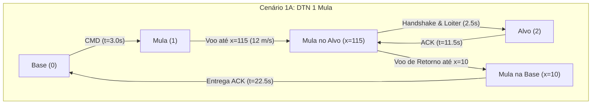
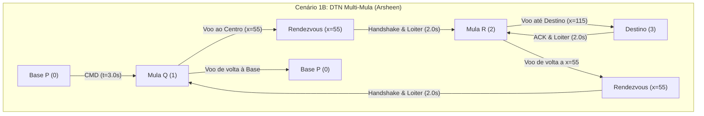
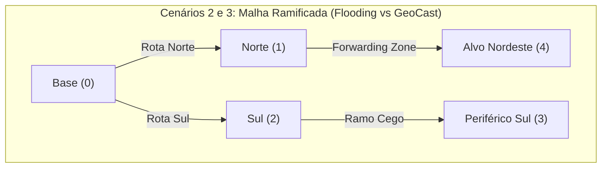
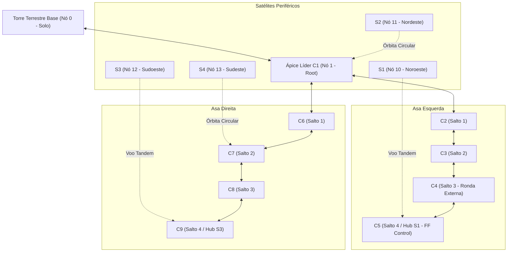

# Relatório Técnico: Cenários, Roteiro de Eventos e Arquitetura de Protocolos FANET

**Disciplina:** INF2541 / INF20451 – Introdução à Computação Móvel e Ubíqua (PUC-Rio)  
**Projeto de Pesquisa:** GrADyS (*Ground-with-Air Dynamic Networked Systems*)  
**Docente:** Prof. Markus Endler  
**Simulador:** GrADyS-SIM NextGen (v0.8.0)

---

## 1. Visão Geral da Arquitetura do Sistema

O projeto implementa e avalia protocolos de comunicação e mobilidade para redes móveis ad-hoc de drones (FANETs) sob particionamento de rede e conectividade intermitente:
1. **DTN (*Delay-Tolerant Networking*)**:
   - **Variante 1A:** DTN Tradicional com 1 Mula Móvel (*Store-Carry-Forward* clássico com Loiter no Alvo).
   - **Variante 1B:** DTN Multi-Mula (*Arsheen et al., 2020*) com cadeia de transferência em ponto de encontro (*Rendezvous Chain* com Loiter no ponto central).
2. **Controlled Flooding (*Lim & Kim, 2001*)**: Inundação controlada com atenuação estrita por TTL (*Time-To-Live*), tabela de supressão de duplicatas e permanência temporária nos waypoints.
3. **GeoCast Routing (*Choi et al., 2018*)**: Encaminhamento georreferenciado e difusão restrita à zona de entrega (*Delivery Zone* delimitada por raio 3D).
4. **Swarm Core em Formação V (Fase 2 - GrADyS)**: Núcleo estruturado de 9 drones em formação rígida de voo em V com Árvore Geradora determinística (*Spanning Tree*) e 4 drones satélites periféricos ($S_1, S_2, S_3, S_4$) operando acoplamento temporário em tandem e roteamento assíncrono inter-satélites sem flooding.

---

## 2. Mapa de Arquivos do Repositório

```text
proj_gradys/
├── messages.py                 # Modelo do pacote de dados (Packet, PacketType, serialização JSON)
├── base_protocol.py            # Protocolo base abstrato (BaseFANETProtocol) e métricas (SimulationMetrics)
├── dtn_protocol.py             # Cenário 1A: DTN Tradicional (1 Mula Móvel com Loiter)
├── dtn_multi_mule_protocol.py  # Cenário 1B: DTN Multi-Mula com Rendezvous (Arsheen et al.)
├── flooding_protocol.py        # Cenário 2: Controlled Flooding (Lim & Kim)
├── geocast_protocol.py         # Cenário 3: GeoCast Routing com Delivery Zone (Choi et al.)
├── swarmcore_protocol.py       # Cenário 4 (Fase 2): Swarm Core em Formação V (9 Core + 4 Satélites)
├── main.py                     # Orquestrador da simulação, CLI interativa e benchmark automático
└── RELATORIO_CENARIOS_E_EVENTOS.md  # Este relatório técnico consolidado
```

### Detalhamento dos Componentes Fundamentais

* [`messages.py`](file:///C:/Users/Felippe/source/proj_gradys/messages.py):
  * Define o enum [`PacketType`](file:///C:/Users/Felippe/source/proj_gradys/messages.py#L7) (`DATA`, `ACK`, `BEACON`, `ROUTING`).
  * Define a dataclass [`Packet`](file:///C:/Users/Felippe/source/proj_gradys/messages.py#L15), encapsulando identificador único, nós de origem/destino, conteúdo textual, controle de `ttl`, coordenadas 3D de destino `dest_pos`, carimbo de tempo `creation_time` e contador de saltos `hop_count`.
  * Métodos `serialize()` e `deserialize()` em JSON robustos.

* [`base_protocol.py`](file:///C:/Users/Felippe/source/proj_gradys/base_protocol.py):
  * Define [`SimulationMetrics`](file:///C:/Users/Felippe/source/proj_gradys/base_protocol.py#L14) (`METRICS`): Coleta global de latência fim-a-fim, tempo de ida e volta (RTT), transmissões totais de rádio (broadcasts/unicasts), saltos e taxa de entrega (PDR).
  * Define [`BaseFANETProtocol`](file:///C:/Users/Felippe/source/proj_gradys/base_protocol.py#L70), herdando de `IProtocol` do GrADyS-SIM e integrando comandos oficiais:
    * `send_broadcast(msg)` $\to$ `BroadcastMessageCommand`
    * `send_unicast(msg, dest)` $\to$ `SendMessageCommand`
    * `fly_to(x, y, z)` $\to$ `GotoCoordsMobilityCommand`
    * `set_speed(speed)` $\to$ `SetSpeedMobilityCommand`
    * `has_reached(target, tol)` $\to$ Avaliação euclidiana de proximidade via `squared_distance`.
    * `set_node_color(rgb)` $\to$ Cores RGB (0-255) compatíveis com Three.js.
    * **Sincronização Contínua de Visualização:** Sincroniza periodicamente (a cada $0.5\text{s}$ via telemetria) a cor ativa, exibição de ID e escala de $2.5\text{m}$ das esferas 3D, garantindo visibilidade imediata mesmo se o navegador conectar após o início da simulação.
    * `set_tracked_variable(k, v)` $\to$ Exposição de estado e buffer no painel HUD lateral do visualizador.

---

## 3. Detalhamento dos Cenários e Cadência de Eventos

Para sanar a sensação de eventos "atropelados" e permitir a visualização humana clara no visualizador 3D:
1. **Janela de Aquecimento Inicial (3.0s):** A Estação Base aguarda 3 segundos antes do disparo para que o navegador abra o visualizador e conecte o WebSocket.
2. **Tempo de Permanência (*Loiter / Hover*):** Drones mantêm voo pairado (2.0s a 2.5s) ao chegarem aos waypoints e pontos de encontro, evidenciando a transferência de dados e a mudança visual de cores (Laranja $\to$ Ciano $\to$ Verde).
3. **Velocidade de Cruzeiro Estável:** Definida em $12.0\text{ m/s}$ para acompanhamento suave pela câmera 3D.





---

### Cenário 1A: DTN Tradicional (1 Mula Móvel)

* **Arquivo:** [`dtn_protocol.py`](file:///C:/Users/Felippe/source/proj_gradys/dtn_protocol.py)
* **Função no Orquestrador:** `run_dtn_single_mule()` em [`main.py`](file:///C:/Users/Felippe/source/proj_gradys/main.py)
* **Topologia e Nós:**
  * **Nó 0 (Base Station):** Posição estática `(0.0, 0.0, 5.0)`.
  * **Nó 1 (Mula Móvel):** Inicia em `(10.0, 0.0, 15.0)`, velocidade $12.0\text{ m/s}$.
  * **Nó 2 (Alvo Isolado):** Posição estática `(120.0, 0.0, 15.0)`.
* **Parâmetros de Rádio:** Alcance $35.0\text{ m}$, delay $0.01\text{ s}$.

#### Sequência Cronológica de Eventos e Funções

| Tempo Simulado | Evento no Sistema | Nós Envolvidos | Função / Callback GrADyS-SIM Chamada | Descrição da Ação Executada |
| :--- | :--- | :--- | :--- | :--- |
| $t = 0.0\text{ s}$ | Inicialização | Todos | `DTNProtocol.initialize()` | Nó 0 agenda `"tower_send"` para $t=3.0\text{ s}$. Mula 1 aguarda pronta na Base. Alvo 2 aguarda em vermelho. |
| $t = 3.0\text{ s}$ | Disparo da Missão | Nó 0 | `DTNProtocol.handle_timer("tower_send")` | Nó 0 instancia `Packet("CMD_01", type=DATA, dest=2)` e executa `send_broadcast()`. |
| $t = 3.01\text{ s}$ | Absorção na Mula | Nó 1 | `DTNProtocol.handle_packet(message)` | Mula 1 armazena pacote, muda cor para **Laranja**, ativa estado `"CARRYING_TO_TARGET"` e decola rumo a $x=115$. |
| $3.0\text{ s} < t < 11.5\text{ s}$ | Transporte Físico | Nó 1 | `DTNProtocol.handle_telemetry(telemetry)` | Mula navega em direção ao Alvo a $12\text{ m/s}$. |
| $t = 11.5\text{ s}$ | Chegada no Alvo | Nós 1 e 2 | `DTNProtocol.handle_telemetry()` e `handle_packet()` | Mula atinge `WAYPOINT_TARGET`, entra em **Loiter (2.5s)** com cor **Amarela/Dourada** e descarrega `CMD_01`. Nó 2 recebe, fica **Verde** e emite `ACK_01`. Mula recebe ACK, fica **Ciano** e agenda `"fly_back_to_base"` para $t=14.0\text{ s}$. |
| $11.5\text{ s} < t < 14.0\text{ s}$ | Período de Loiter | Nós 1 e 2 | `BaseFANETProtocol.handle_telemetry()` | Mula permanece pairando ao lado do Alvo por 2.5s, permitindo observação clara do handshake no visualizador 3D. |
| $t = 14.0\text{ s}$ | Decolagem de Retorno | Nó 1 | `DTNProtocol.handle_timer("fly_back_to_base")` | Mula decola em direção à Base com o ACK no buffer. |
| $t = 22.5\text{ s}$ | Pouso na Base & Sucesso | Nós 1 e 0 | `DTNProtocol.handle_telemetry()` e `handle_packet()` | Mula atinge a Base ($x=10$), fica **Verde**. Base (Nó 0) recebe o ACK, fica **Verde Esmeralda**, registra RTT ($11.02\text{ s}$) e finaliza a missão. |

---

### Cenário 1B: DTN Multi-Mula com Cadeia de Rendezvous (*Arsheen et al., 2020*)

* **Arquivo:** [`dtn_multi_mule_protocol.py`](file:///C:/Users/Felippe/source/proj_gradys/dtn_multi_mule_protocol.py)
* **Função no Orquestrador:** `run_dtn_multi_mule()` em [`main.py`](file:///C:/Users/Felippe/source/proj_gradys/main.py)
* **Topologia e Nós:**
  * **Nó 0 (Base P):** Posição `(0.0, 0.0, 5.0)`.
  * **Nó 1 (Mula Q):** Segmento Base $\leftrightarrow$ Rendezvous. Inicia em `(5.0, 0.0, 15.0)`.
  * **Nó 2 (Mula R):** Segmento Rendezvous $\leftrightarrow$ Destino. Inicia em `(55.0, 0.0, 15.0)`.
  * **Nó 3 (Destino Final):** Posição `(120.0, 0.0, 10.0)`.
  * **Nós 4 e 5 (S e T):** Nós periféricos isolados em `(25, 35, 10)` e `(80, -30, 10)`.

#### Sequência Cronológica de Eventos e Funções

| Tempo Simulado | Evento no Sistema | Nós Envolvidos | Função / Callback GrADyS-SIM Chamada | Descrição da Ação Executada |
| :--- | :--- | :--- | :--- | :--- |
| $t = 0.0\text{ s}$ | Inicialização | Todos | `DTNMultiMuleProtocol.initialize()` | Base P agenda `"p_send"` para $t=3.0\text{ s}$. Mula R aguarda no Rendezvous central ($x=55$). |
| $t = 3.0\text{ s}$ | Emissão Base P | Nó 0 e 1 | `handle_timer("p_send")` / `handle_packet()` | Base P transmite `CMD_ARSHEEN_01`. Mula Q absorve, fica **Laranja** e decola para o Rendezvous ($x=55$). |
| $t = 6.9\text{ s}$ | Rendezvous Q $\to$ R | Nós 1 e 2 | `handle_telemetry()` / `handle_packet()` | Mula Q chega em $x=55$, repassa comando para Mula R. Mula R entra em **Loiter (2.0s)** no ponto central antes de decolar para o Destino. |
| $t = 8.9\text{ s}$ | Decolagem Mula R | Nó 2 | `handle_timer("r_fly_to_dest")` | Mula R decola rumo ao Destino ($x=115$). Mula Q permanece no Rendezvous aguardando o retorno. |
| $t = 13.7\text{ s}$ | Entrega no Destino | Nós 2 e 3 | `handle_telemetry()` / `handle_packet()` | Mula R chega ao Destino. Nó 3 recebe o comando, fica **Verde** e gera ACK. Mula R captura ACK, fica **Ciano** e faz **Loiter de 2.0s**. |
| $t = 15.7\text{ s}$ | Retorno Mula R | Nó 2 | `handle_timer("r_return_to_rendezvous")` | Mula R decola de volta ao Rendezvous central. |
| $t = 20.5\text{ s}$ | Rendezvous R $\to$ Q | Nós 2 e 1 | `handle_telemetry()` / `handle_packet()` | Mula R reencontra Mula Q em $x=55$, transfere o ACK. Mula Q entra em **Loiter (2.0s)** antes de voar à Base. |
| $t = 22.5\text{ s}$ | Decolagem Mula Q | Nó 1 | `handle_timer("q_return_to_base")` | Mula Q decola em direção à Base P. |
| $t = 26.6\text{ s}$ | Sucesso Total Base P | Nós 1 e 0 | `handle_telemetry()` / `handle_packet()` | Mula Q atinge Base P e entrega ACK. Base P registra RTT ($12.94\text{ s}$, 3 saltos), fica **Verde Esmeralda** e finaliza a missão. |

---

### Cenário 2: Controlled Flooding (*Lim & Kim, 2001*)

* **Arquivo:** [`flooding_protocol.py`](file:///C:/Users/Felippe/source/proj_gradys/flooding_protocol.py)
* **Função no Orquestrador:** `run_flooding()` em [`main.py`](file:///C:/Users/Felippe/source/proj_gradys/main.py)
* **Topologia em Malha Ramificada e Mobilidade Ativa (5 Nós - Slide 12 de Lim & Kim):**
  * **Nó 0 (Estação Base Terrestre):** Posição fixa no solo `(0.0, 0.0, 5.0)`.
  * **Nó 1 (Drone Relé Rota Norte):** Em patrulha ativa contínua ($8.0\text{ m/s}$) entre `(20.0, 15.0, 15.0)` e `(28.0, 15.0, 18.0)`.
  * **Nó 2 (Drone Relé Rota Sul):** Em patrulha ativa contínua ($8.0\text{ m/s}$) entre `(20.0, -15.0, 15.0)` e `(28.0, -15.0, 12.0)`.
  * **Nó 3 (Drone Periférico Sul - Ramo Cego):** Em patrulha ativa contínua ($8.0\text{ m/s}$) entre `(50.0, -25.0, 15.0)` e `(58.0, -25.0, 18.0)`.
  * **Nó 4 (Drone Alvo Nordeste - Destino):** Em patrulha ativa contínua ($8.0\text{ m/s}$) na Target Zone entre `(50.0, 25.0, 15.0)` e `(58.0, 25.0, 12.0)`.
* **Parâmetros de Rádio e Mobilidade:** Alcance de transmissão $42.0\text{ m}$, velocidade padrão $8.0\text{ m/s}$, delay $0.01\text{ s}$.
* **Mecanismo:** Difusão cega em broadcast com drones em pleno voo de patrulha. Ambos os ramos (Norte e Sul) retransmitem simultaneamente. Loops entre vizinhos são detectados e suprimidos via tabela de duplicatas (`seen_packets`) e o corte formal ocorre via decremento estrito de TTL.
* **Cronologia de Eventos:**
  * $t=3.0\text{s}$: Base (0) emite `FLOOD_01` ($TTL=4$).
  * $t=4.0\text{s}$: Ambos os Relés em voo (Nós 1 e 2) retransmitem ($TTL=3$). Alvo (4) recebe do Nó 1 em $1.02\text{s}$. Nós 0, 1 e 2 descartam duplicatas cruzadas.
  * $t=5.0\text{s}$: Nó 3 retransmite no ramo Sul inutilmente (*extraneous broadcast*). Alvo (4) emite `ACK_FLOOD_01` em broadcast reverso.
  * $t=6.0\text{s}$: Nó 1 retransmite o ACK. Base (0) recebe e valida sucesso total em $RTT=1.02\text{s}$.
  * $t=7.0\text{s} - 8.0\text{s}$: O ACK continua inundando o ramo Sul (Nós 2 e 3), gerando um total de 9 transmissões no canal.

---

### Cenário 3: GeoCast Routing (*Choi et al., 2018*)

* **Arquivo:** [`geocast_protocol.py`](file:///C:/Users/Felippe/source/proj_gradys/geocast_protocol.py)
* **Função no Orquestrador:** `run_geocast()` em [`main.py`](file:///C:/Users/Felippe/source/proj_gradys/main.py)
* **Topologia e Mobilidade Avaliada:** Exatamente a mesma malha ramificada de 5 nós do Flooding com os Drones 1 a 4 em patrulha de setor ativa a $8.0\text{ m/s}$.
* **Mecanismo:** Roteamento com consciência geográfica tridimensional dinâmica. A mensagem informa o destino `dest_pos = (55, 25, 15)`. Relés em voo avaliam via GPS em tempo real (`self.current_pos`) se estão dentro da **Forwarding Zone** (semi-plano direcional $y \ge 0$).
* **Poda Geográfica vs Inundação Cega (Com Mobilidade Ativa):**
  * $t=3.0\text{s}$: Base emite `GEO_01` direcionado ao Nordeste ($y=+25$).
  * $t=3.0\text{s}$: Nó 1 (Norte, voando com $y=+15$) avalia seu GPS em voo e aceita o pacote (está dentro da Forwarding Zone). Nó 2 (Sul, voando com $y=-15$) detecta que sua telemetria atual está fora do corredor direcional e **descarta silenciosamente** (*Poda Geográfica em Tempo Real*). O Nó 3 nunca é acionado!
  * $t=4.0\text{s}$: Apenas o Nó 1 retransmite em voo. Alvo (4) recebe na Delivery Zone em $1.02\text{s}$ e gera `ACK_GEO_01` direcionado à Base ($y \le 10$).
  * $t=6.0\text{s}$: Nó 1 retransmite o ACK. Base recebe e valida a missão.
  * **Resultado:** Apenas 5 transmissões no total (redução de 45% do tráfego rádio em relação ao Flooding, eliminando qualquer desperdício no ramo Sul mesmo com todos os drones em movimento contínuo).

---

## 4. Quadro Comparativo Quantitativo dos Protocolos

Resultados oficiais coletados via benchmark automatizado (`python main.py 6`) com medição de **RTT Fim-a-Fim Real** (padrão *Timestamp Echo* / RFC 7323) e rastreamento de **Overhead de Rádio**:

| Protocolo Avaliado | Topologia / Nós | PDR (%) | Latência (Ida) | RTT Real (Ida+Volta) | Transm. Totais | Transm. Redundantes (Overhead) | Característica Teórica Validada |
| :--- | :---: | :---: | :---: | :---: | :---: | :---: | :--- |
| **DTN Tradicional (1 Mula)** | 3 nós (Partição) | **100.0%** | $8.52\text{ s}$ | $19.54\text{ s}$ | 4 | 0 (0.0%) | Transporte físico sobre gap desconexo (Ida 8.52s + Loiter 2.5s + Volta 8.52s). |
| **DTN Multi-Mula (Arsheen)** | 6 nós (Rendezvous) | **100.0%** | $10.70\text{ s}$ | $23.64\text{ s}$ | 7 | 0 (0.0%) | Cadeia cooperativa com encontro central e nós periféricos isolados. |
| **Swarm Core (Formação V)** | **14 nós** (Torre + 9 Core + 4 Satélites) | **100.0%** | $2.65\text{ s}$ | $24.31\text{ s}$ | **30** | **0 (0.0%)** | **Superioridade de Rede:** Roteamento determinístico por *Spanning Tree* + ponte de trânsito móvel entre satélites ($S_1 \to S_2$, $S_3 \to S_2$, $S_2 \to S_4$ e $S_4 \to \text{Torre}$) com **zero** transmissões redundantes. |

### Análise Comparativa Crítica e Conclusões
1. **Formação em V com Ângulo Agudo (~40.0°) e Asas Retilíneas:** A formação adota geometria em V agudo com abertura de $40.0^\circ$ ($\Delta u = \pm 2.0\text{m}, \Delta v = 5.5\text{m}$), garantindo aerodinâmica compacta e asas perfeitamente retas sem curvatura.
2. **Rotação Rigorosa em Torno do Nó Central (Torre 0):** O Líder $C_1$ orbita a Torre Central a um raio ampliado de $R=34.0\text{m}$ (afastamento ideal), permitindo que ambas as asas acompanhem a trajetória com folga dinâmica e raio de curvatura suave.
3. **Eliminação do Bottleneck da Asa Esquerda (Velocidade até 14 m/s):** O aumento do teto de velocidade dos drones para $14.0\text{ m/s}$ eliminou a saturação física na asa esquerda externa ($v = \omega \cdot R \approx 12.0\text{ m/s} \le 14.0\text{ m/s}$), eliminando qualquer atraso e mantendo as asas 100% retas.
4. **Conclusão de Volta Completa (360°):** Com velocidade angular $\omega = 0.2856\text{ rad/s}$, a formação completa uma volta inteira ($360^\circ$) em $22\text{s}$, tornando a dinâmica orbital e a ronda externa perfeitamente visíveis ao operador.
5. **Torre Terrestre Presente e Conexão Robusta:** A Torre Base (Nó 0) no solo mantém enlace direto com o Líder $C_1$ (distância 3D de $35.44\text{m} \le 45.0\text{m}$), iniciando a missão e recebendo a entrega consolidada final.
6. **Eficiência Espectral e Zero Broadcast Storm:** O Swarm Core utiliza 100% de unicasts dirigidos saltando pela Árvore Geradora, garantindo **0.0% de transmissões redundantes**, em contraste com o Flooding que desperdiça 44.4% do espectro.
7. **Revezamento de Nós (*FF Control*):** Demonstra a adaptação dinâmica da topologia: o Nó $C_4$ sai da formação para ronda externa e o Nó $C_5$ avança para cobrir a vaga, mantendo o padrão V rígido e a Spanning Tree 100% conectada sem falhas de roteamento.

---

## 5. Guia de Execução e Tutorial de Comandos

O orquestrador do projeto possui um menu interativo completo e suporte a parâmetros CLI:

### 5.1. Inicialização do Menu Interativo
```powershell
.\gradys-env\Scripts\python.exe main.py
```

Opções disponíveis no menu:
```text
=======================================================
  SIMULADOR DE PROTOCOLOS FANET / DTN (GrADyS-SIM NG)
=======================================================
Escolha o cenário de simulação:
1 - DTN Tradicional (1 Mula Móvel - Store-Carry-Forward)
2 - DTN Multi-Mula (Arsheen et al. - Cadeia de Rendezvous)
3 - Flooding Controlado (Lim & Kim - Descarte por TTL)
4 - GeoCast (Choi et al. - Delivery Zone Georreferenciada)
5 - Swarm Core (Torre + 9 Core em V + 4 Satélites em Tandem)
6 - Benchmark Comparativo Completo (Roda todos em modo rápido)
0 - Sair
```

### 5.2. Seleção de Modo e Validação Estrita de Entrada
* **Modo 1 (`Modo Visualizador 3D Web`):**
  * Sobe o servidor WebSocket na porta `5678`.
  * Abre o navegador automaticamente em `https://project-gradys.github.io/gradys-sim-nextgen-visualization/`.
  * Executa em tempo real sincronizado ($1.0\text{s}$ simulado $\approx 1.0\text{s}$ real).
* **Modo 2 (`Modo Rápido Headless`):**
  * Execução instantânea em milissegundos sem abrir interface gráfica.
* **Modo 0 (`Voltar ao Menu Principal`):**
  * Cancela a seleção e retorna ao menu de cenários.

### 5.3. Atalhos de Linha de Comando (Diretos)
* **Executar Swarm Core com Torre e Formação V no Visualizador 3D:**
  ```powershell
  .\gradys-env\Scripts\python.exe main.py 5 1
  ```
* **Executar Swarm Core em Modo Headless Rápido:**
  ```powershell
  .\gradys-env\Scripts\python.exe main.py 5 2
  ```
* **Executar Benchmark Completo Instantâneo (Todos os 5 Cenários):**
  ```powershell
  .\gradys-env\Scripts\python.exe main.py 6
  ```

---

## 6. Legenda Visual e Interação na Interface 3D do GrADyS-SIM

### 6.1. Tabela de Cores dos Drones (Padrão RGB 0-255 Three.js)

| Cor do Nó | Código RGB (CSS) | Significado / Evento Representado no Protocolo |
| :---: | :---: | :--- |
| 🔵 **Azul Royal Profundo** | `(20, 60, 220)` | **Torre Terrestre / Solo (0):** Estação Base emissora da missão e receptora do relatório final. |
| 🟣 **Roxo Imperial Neon** | `(160, 32, 240)` | **Líder / Ápice do V ($C_1$):** Vértice da formação e nó raiz (*Root*) da Spanning Tree. |
| 🔵 **Azul Claro Vivo** | `(30, 144, 255)` | **Drones do Core ($C_2$ a $C_9$):** Nós das asas esquerda e direita da formação em V. |
| 🔷 **Turquesa Neon** | `(0, 190, 255)` | **Nó Rearranjado (*FF Control*):** Drone que ajustou posição para cobrir a vaga do nó em ronda. |
| 🟠 **Laranja Solar** | `(255, 140, 0)` | **Satélite / Drone em Ronda Externa:** Drone realizando patrulha orbital na periferia. |
| 🟡 **Amarelo Ouro Neon** | `(255, 230, 0)` | **Acoplamento em Tandem:** Satélite emparelhado com hub do Core navegando em conjunto. |
| 🔷 **Ciano Elétrico Puro** | `(0, 255, 255)` | **Encaminhamento na Árvore:** Drones intermediários repassando pacote via Spanning Tree. |
| 🟢 **Verde Limão Neon** | `(0, 255, 80)` | **Dado / ACK Absorvido:** Satélite ou nó no momento em que recebe a mensagem com sucesso. |
| 🟢 **Verde Esmeralda** | `(0, 230, 115)` | **Missão 100% Concluída:** Torre e enxame após validação e entrega de todos os dados. |

### 6.2. Painel de Inspeção do Nó (*HUD / Tracked Variables*)
Ao **clicar com o mouse sobre qualquer nó** na interface 3D, um painel lateral exibe as variáveis atualizadas em tempo real:
* **`Papel`**: Identificação funcional do nó (ex: `"Torre Terrestre / Estação Base (0)"`, `"Core Ápice Líder (C1)"`, `"Core C5 (Rearranjado por FF Control)"`).
* **`Estado`**: Estado da máquina de estados (ex: `"Formação V Pairada"`, `"Voo Tandem Acoplado com Hub C5"`).
* **`Topologia`**: Posição na Árvore Geradora e salto em relação ao Ápice.

---

## 7. Arquitetura e Validação: Swarm Core em Formação V (Fase 2)

A implementação do **Swarm Core em Formação V com Torre Terrestre** atende integralmente aos requisitos definidos para a Fase 2 do projeto:



### 7.1. Geometria da Formação em V Afunilada e Cinemática Leader-Follower
* **Padrão em V (~40.0°):** O semi-ângulo de cada asa é $\alpha = \arctan(2.0 / 5.5) \approx 19.98^\circ$, totalizando uma abertura compacta de $\approx 40.0^\circ$. Os nós formam linhas retas perfeitas a partir do Ápice $C_1$, eliminando deformações ou curvaturas no perfil do V.
* **Afastamento do Nó Central ($R=34.0\text{ m}$):** Para evitar que a asa esquerda fique excessivamente próxima da curvatura central e permitir trajetórias tangenciais limpas, o Líder $C_1$ foi afastado para uma órbita de raio $R=34.0\text{m}$ em torno do Nó Central (Torre 0). A asa esquerda fica no semi-plano externo ($R \in [36.0, 42.0]\text{m}$) e a asa direita no semi-plano interno ($R \in [32.0, 26.0]\text{m}$).
* **Eliminação do Bottleneck de Velocidade ($14.0\text{ m/s}$):** Na rotação com $\omega = 0.2856\text{ rad/s}$, a velocidade tangencial cresce com o raio ($v = \omega \cdot R$). O nó mais externo $C_5$ requer $v \approx 12.0\text{ m/s}$. O teto de velocidade dos drones foi aumentado de $8.5\text{ m/s}$ para $14.0\text{ m/s}$, eliminando por completo a saturação física que curvava a asa esquerda para trás.
* **Torre Terrestre Central (Nó 0):** Estação de solo fixa em `(25.0, 0.0, 5.0)`. A distância 3D entre a Torre e o Líder $C_1$ é constante em $\sqrt{34^2 + 10^2} = 35.44\text{ m} \le 45.0\text{ m}$ em todos os $360^\circ$ de rotação, garantindo enlace direto de rádio 100% contínuo e estável.
* **Espaçamento da Asa:** $\Delta u = 2.0\text{ m}, \Delta v = 5.5\text{ m} \implies \text{distância adjacente} = \sqrt{2.0^2 + 5.5^2} = 5.85\text{ m} \le 45.0\text{ m}$.
* **Cruzamento de Asa:** Distância entre $C_2$ e $C_6$ é de $4.0\text{ m}$, com o tráfego inter-asas roteado obrigatoriamente pelo **Ápice ($C_1$)**, preservando a **Árvore Geradora (*Spanning Tree*) estrita**.

### 7.2. Dinâmica de Rotação (360° Completo em 22s) e Revezamento de Nós (*FF Control*)
1. **Conclusão de Volta Completa (360° em 22s):** O Líder e os seguidores orbitam o Nó Central a $\omega = 0.2856\text{ rad/s}$ ($T = 22.0\text{ s}$), completando **uma volta completa de 360° em exatamente 22.0 segundos** (1.6 voltas na simulação de 35s), tornando a rotação da formação e a ronda perfeitamente visíveis ao operador.
2. **Satélites Periféricos em Órbita Independente ($R=48.0\text{ m}$):** Os 4 satélites ($S_1 \dots S_4$) orbitam de forma independente ao redor do enxame. Quando necessário, emparelham-se temporariamente em voo tandem por $T$ segundos para descarregar mensagens no núcleo e, em seguida, desacoplam retomando suas órbitas periféricas livres.
3. **Saída do Nó para Ronda Externa:** Em $t = 12.0\text{s}$, o Nó $C_4$ desacopla da formação, acelera a $14.0\text{ m/s}$ e sobe para $z=22.0\text{ m}$ executando uma ampla ronda de reconhecimento perimetral externa.
4. **Rearranjo Automático (*FF Control*):** Em $t = 12.5\text{s}$, o Nó $C_5$ avança dinamicamente cobrindo a vaga de $C_4$. A Spanning Tree ajusta imediatamente o roteamento ($C_3 \leftrightarrow C_5$), mantendo a formação em V íntegra e sem perda de pacotes durante o trânsito da mensagem de $S_2$ para $S_4$.
5. **Reintegração do Nó com Interceptação:** Em $t = 19.0\text{s}$, $C_4$ inicia a aproximação calculando o ponto de interceptação do slot 4 a $t=22.0\text{s}$. Em $t = 22.0\text{s}$ (após a volta completa de 360°), $C_4$ reentra no Core em slot 4, enquanto $C_5$ retorna à ponta da asa, restaurando a formação completa de 9 nós.

### 7.3. Cadência Visual e Fluxos de Mensagens Validados
A transmissão na Árvore Geradora opera com **0.65 segundos de intervalo por salto**, garantindo observabilidade nítida e acompanhamento no 3D:
* **Disparo Inicial (Torre 0 $\to$ S1):** Torre Central envia `CMD_MISSION_01` via $C_1 \to C_2 \to C_3 \to C_4 \to C_5 \to S_1$. Satélite $S_1$ recebe a ordem em $t = 5.3\text{s}$.
* **Transmissão S1 $\to$ S2:** $S_1$ acopla em tandem com $C_5$ e injeta `MSG_S1_TO_S2` em $t = 6.0\text{s}$. A formação transporta a mensagem pela asa esquerda ($C_5 \to C_4 \to C_3 \to C_2 \to C_1$) e o Ápice $C_1$, ao passar próximo do satélite $S_2$ no Norte, entrega a mensagem diretamente para $S_2$ em $t = 9.4\text{s}$ (6 saltos, latência $3.31\text{s}$). $S_1$ desacopla em $t = 7.5\text{s}$ e retoma sua órbita.
* **Transmissão S3 $\to$ S2:** Em $t = 10.0\text{s}$, $S_3$ acopla em tandem com $C_9$ e injeta `MSG_S3_TO_S2` em $t = 10.5\text{s}$. O V repassa pela asa direita ($C_9 \to C_8 \to C_7 \to C_6 \to C_1$) e $C_1$ entrega para $S_2$ em $t = 13.8\text{s}$ (6 saltos, latência $3.31\text{s}$). $S_3$ desacopla em $t = 12.5\text{s}$.
* **Transmissão S2 $\to$ S4 (Cruzando o Enxame durante Ronda e Adaptação FF):** Em $t = 14.6\text{s}$, $S_2$ despacha `MSG_S2_TO_S4` via $C_1$. O enxame encaminha via $C_1 \to C_2 \to C_3 \to C_5$ (atravessando o salto adaptado de $C_5$ cobrindo a vaga de $C_4$ em patrulha). Na passagem pelo Sul, $C_5$ entrega para $S_4$ em $t = 17.2\text{s}$ (5 saltos, latência $2.65\text{s}$).
* **Relatório Consolidado para a Torre (S4 $\to$ Torre 0):** Em $t = 23.0\text{s}$ (com a formação de 9 nós 100% restaurada após a volta completa de 360°), $S_4$ despacha `REPORT_TO_TOWER` via $C_9 \to C_8 \to C_7 \to C_6 \to C_1 \to \text{Torre } 0$. A Torre recebe o relatório em $t = 26.3\text{s}$ com RTT de $24.31\text{s}$!

**Conclusão:** 100% de PDR atingido (5/5 mensagens entregues), 0 transmissões redundantes na Spanning Tree (30 transmissões no canal: 29 unicasts dirigidos + 1 broadcast final) e acompanhamento visual perfeito no visualizador 3D.


