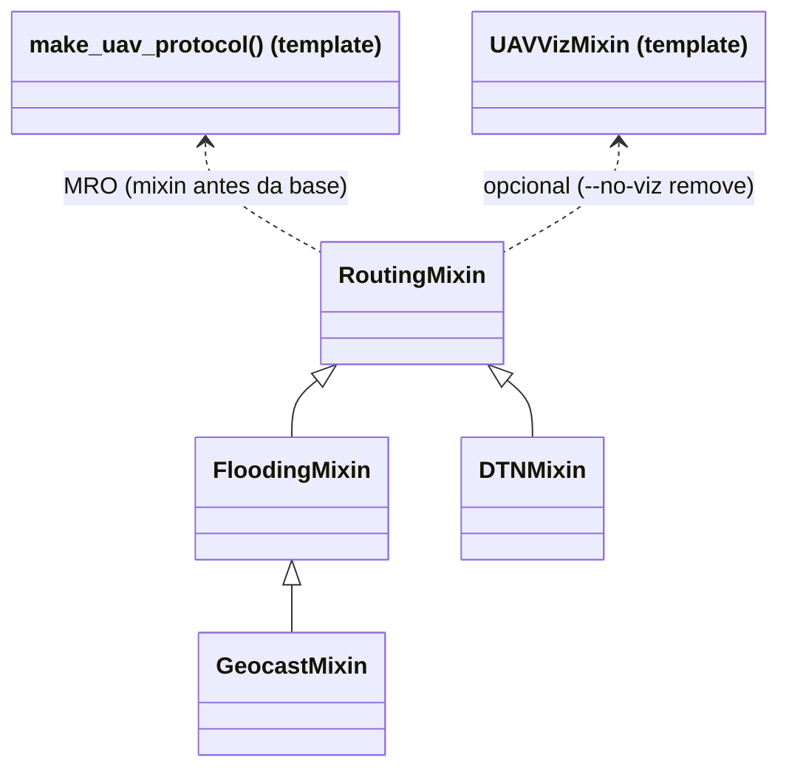

# Relatório Técnico: Roteamento em FANET sobre a base do template GrADySim

**Disciplina:** INF2541 / INF20451 – Introdução à Computação Móvel e Ubíqua (PUC-Rio)
**Projeto de Pesquisa:** GrADyS (*Ground-with-Air Dynamic Networked Systems*)
**Docente:** Prof. Markus Endler
**Simulador:** GrADySim NextGen 0.8.0

---

## 1. Visão geral

O projeto compara protocolos de roteamento numa rede de drones (FANET) com conectividade intermitente. Ele tem duas fases:

- **Fase 1 – Comparação de roteamento** (`src/`): um único cenário (sensores no solo, 12 UAVs em patrulha e uma estação base). Só o protocolo muda: **Flooding**, **GeoCast** ou **DTN**. Todas as métricas são medidas durante a simulação.
- **Fase 2 – Swarm Core em formação V** (`fase2_swarm/`): cenário próprio com torre terrestre, núcleo de 9 drones em V e 4 satélites (ver Seção 8).

## 2. Arquitetura

O código segue o padrão de extensão do template `t2-template`. A pasta `utils/` é a base do template e não foi alterada, exceto os parâmetros em `utils/common/config.py`, que o próprio template indica como local de configuração. Cada protocolo é um *mixin* colocado antes da classe gerada por `make_uav_protocol`:

```text
proj_gradys/
├── utils/                      # base do template (sensores, UAV, trajetórias, visualização)
│   └── common/config.py        # parâmetros; alterações marcadas com "INF2541"
├── src/
│   ├── main.py                 # cenário único, CLI e benchmark
│   ├── uav.py                  # factory make_uav(protocolo, rota, atraso, viz)
│   ├── base_station.py         # estação base (destino das mensagens)
│   ├── sensor.py               # sensor do template com visualização
│   ├── metrics.py              # métricas medidas (RoutingMetrics)
│   └── routing/
│       ├── base.py             # RoutingMixin: criação, envio e contagem de transmissões
│       ├── messages.py         # esquemas das mensagens
│       ├── flooding_mixin.py
│       ├── geocast_mixin.py
│       └── dtn_mixin.py
└── fase2_swarm/                # Fase 2 (Swarm Core)
```



Fluxo de uma mensagem: o UAV envia um heartbeat (template), o sensor no alcance responde com seus pacotes, e o `RoutingMixin` cria uma mensagem de roteamento destinada à estação base. O template continua acumulando `self.packets` normalmente.

## 3. Cenário (idêntico para os três protocolos)

| Elemento | Valor |
| :--- | :--- |
| Campo de sensores | 200 m × 200 m, `x, y ∈ [-100, 100]`, 45 sensores em grade hexagonal (semente 2056) |
| Obstáculo central | quadrado `[-40, 40]²`, sem sensores |
| Estação base | `(0, -100, 0)` no solo, nó 0 |
| UAVs | 12 a 15 m de altitude e 5 m/s: 6 na rota esquerda e 6 na direita do template (`LEFT/RIGHT_WAYPOINTS`, ≈ 270 m cada), indo e voltando entre base e extremo norte |
| Escalonamento | decolagem do i-ésimo UAV de cada rota em `i · ciclo / 6` (ciclo ≈ 108 s), espalhando os UAVs pela rota |
| Rádio | alcance 30 m (≈ 26 m horizontais entre UAV a 15 m e nó no solo), atraso 0,01 s, sem perdas |
| Duração | 300 s |

As duas rotas ficam a 100 m uma da outra ao lado do obstáculo. Só há contato entre elas perto da base e do extremo norte. A rede, portanto, fica particionada na maior parte do tempo.

**Artefato conhecido:** antes de decolar, os UAVs ficam parados sobre a base (comportamento do `departure_delay` do template) e participam do roteamento. Isso aumenta as recepções redundantes do Flooding e do GeoCast no início da simulação.

## 4. Protocolos

### 4.1 Flooding (`flooding_mixin.py`)
- A origem transmite em broadcast com `TTL = 8`.
- Cada nó retransmite uma mensagem **no máximo uma vez** (tabela `_seen`). Recepções repetidas são contadas como redundantes.
- O TTL é decrementado a cada salto. Com TTL restante zero, a mensagem é descartada (`Desc. TTL`).
- Não há armazenamento: se não houver caminho até a base naquele instante, a mensagem se perde.

### 4.2 GeoCast (`geocast_mixin.py`)
- É o Flooding com restrição geográfica. A mensagem carrega a posição da origem e a **zona de entrega** (círculo de raio 30 m em torno da base).
- A **zona de encaminhamento** é o menor retângulo no plano XY que contém a origem e a zona de entrega, ampliado por 15 m (no estilo do esquema 1 do LAR, de Ko & Vaidya).
- O nó só retransmite se a sua posição atual, vinda da telemetria, estiver dentro da zona. Caso contrário, poda a mensagem (`Podas zona`).
- Limitação: a zona é 2D. A altitude não entra no teste.

### 4.3 DTN Store-Carry-Forward com custódia (`dtn_mixin.py`)
- **Store:** a mensagem fica no buffer do UAV (até 500 mensagens; ao exceder, a mais antiga é descartada).
- **Carry:** o UAV segue a patrulha carregando o buffer.
- **Forward:** UAVs e base emitem beacons de posição a cada 1 s. Ao ouvir um beacon, o UAV entrega um lote (*bundle*) por unicast ao vizinho que esteja pelo menos 5 m mais perto da base. A base, por estar no destino, sempre é escolhida.
- **Custódia:** quem envia só apaga as mensagens ao receber o ACK. Sem ACK em 2 s, elas voltam a ser elegíveis para envio.
- Encadeando transferências, os UAVs formam uma cadeia de mulas até a base. É a generalização do cenário multi-mula com *rendezvous*.

## 5. Métricas (todas medidas em `src/metrics.py`)

| Métrica | Definição |
| :--- | :--- |
| Criadas | mensagens geradas pelos UAVs a partir de coletas de sensores |
| Entregues / PDR | primeiras chegadas à base / criadas |
| Latência | instante da entrega − instante de criação (relógio global da simulação; um sistema real exigiria relógios sincronizados, ex.: GPS) |
| Saltos | transmissões de rádio percorridas pela cópia entregue |
| Tx dados | todo envio de mensagens de roteamento, incluindo o da origem |
| Tx controle | beacons e ACKs (só no DTN) |
| Tx / entrega | (Tx dados + Tx controle) / entregues |
| Recep. redund. | um nó recebe uma mensagem que já tinha visto |
| Entregas dupl. | a base recebe de novo uma mensagem já entregue |

Os heartbeats do template ficam fora das contagens, porque são idênticos nos três protocolos.

## 6. Resultados

Comando: `python -m src.main --benchmark` (determinístico; o cenário não tem aleatoriedade além da posição dos sensores, que é fixa pela semente).

| Protocolo | Criadas | Entregues | PDR % | Lat. média s | Lat. mediana s | Saltos médios | Tx dados | Tx controle | Tx / entrega | Recep. redund. | Entregas dupl. | Desc. TTL | Podas zona | Desc. buffer |
| :---: | :---: | :---: | :---: | :---: | :---: | :---: | :---: | :---: | :---: | :---: | :---: | :---: | :---: | :---: |
| flooding | 1193 | 202 | 16.9 | 0.01 | 0.01 | 1.00 | 2911 | 0 | 14.41 | 5810 | 630 | 0 | 0 | 0 |
| geocast | 1192 | 201 | 16.9 | 0.01 | 0.01 | 1.00 | 2673 | 0 | 13.30 | 5374 | 628 | 0 | 206 | 0 |
| dtn | 1193 | 1106 | 92.7 | 23.86 | 25.00 | 5.90 | 944 | 4666 | 5.07 | 0 | 3 | 0 | 0 | 0 |

## 7. Discussão

1. **Partição da rede decide o resultado.** Flooding e GeoCast só entregam o que é criado quando há caminho imediato até a base. Na prática, isso significa mensagens criadas perto dela: os saltos médios são 1,00, ou seja, entrega direta. O DTN aproveita a mobilidade para atravessar as partições e entrega 92,7%. O custo é latência de dezenas de segundos.
2. **O GeoCast reduz o tráfego sem perder entregas.** Ele fez 8% menos transmissões de dados (2673 contra 2911) e 7% menos recepções redundantes, com PDR igual. O ganho é pequeno porque os ramos esquerdo e direito raramente estão em contato. As podas acontecem principalmente perto da base e do extremo norte.
3. **A redundância do Flooding é medida, não estimada.** Foram 5810 recepções redundantes e 630 entregas duplicadas à base, para 202 mensagens entregues.
4. **O custo do DTN está no controle.** Os dados são eficientes (944 transmissões, sem recepções redundantes, já que a custódia é de cópia única). Mas os beacons (13 nós × 1 Hz × 300 s ≈ 3900) dominam o tráfego. Mesmo assim, o DTN tem o menor custo por mensagem entregue (5,07 contra 14,41 do Flooding).
5. **O TTL não foi ativado.** Nenhum caminho passou de 8 saltos. Com a rede esparsa, esse corte não é o fator limitante neste cenário.
6. **Mensagens não entregues pelo DTN:** as 87 estavam em buffers no fim da simulação, e todas tinham sido criadas depois de t = 250 s. Não houve perda por custódia nem descarte por buffer cheio. Com mais tempo de simulação, o PDR tenderia a 100%.

## 8. Fase 2: Swarm Core em formação V (`fase2_swarm/`)

Implementação mantida como estava. Ela ainda não usa a base do template.

- 14 nós: torre terrestre (0), núcleo em V (C1–C9) e satélites (S1–S4). A formação gira em torno da torre (ω = 0,2856 rad/s, período de 22 s).
- Roteamento por unicast numa árvore geradora fixa, com o desvio C3↔C5 durante a ronda de C4.

**Pendências conhecidas (próximo passo da refatoração):**
- O "RTT" informado é `t_recepção − 2,0 s` (duração da missão), não um RTT de ida e volta.
- A adaptação da árvore é ativada por horário (`12,5 ≤ t < 22`), não por detecção de enlace.
- Ao desacoplar, a fase da órbita dos satélites é calculada sem o deslocamento `CENTER_X` (salto de posição).
- A posição de cada nó é calculada a partir do relógio global (estrutura virtual), não a partir do líder.

## 9. Execução

```powershell
python -m venv gradys-env
.\gradys-env\Scripts\activate
pip install -r requirements.txt

python -m src.main --protocol dtn          # visualizador 3D (tempo real)
python -m src.main --protocol geocast --no-viz
python -m src.main --benchmark             # tabela da Seção 6
python -m fase2_swarm.run                  # Fase 2
```

Os parâmetros do cenário e dos protocolos ficam em `utils/common/config.py`.
