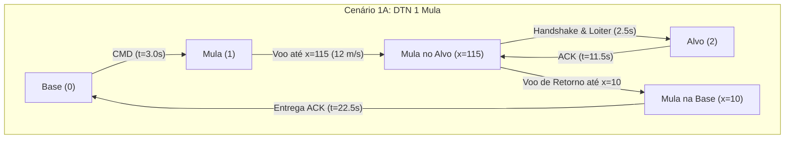
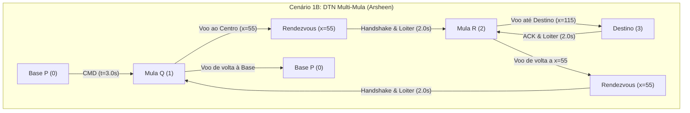
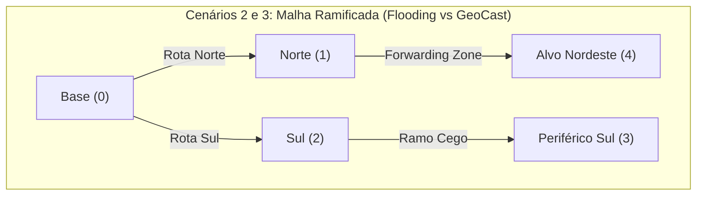

# Relatório Técnico: Cenários, Roteiro de Eventos e Arquitetura de Protocolos FANET

**Disciplina:** INF2541 / INF20451 – Introdução à Computação Móvel e Ubíqua (PUC-Rio)  
**Projeto de Pesquisa:** GrADyS (*Ground-with-Air Dynamic Networked Systems*)  
**Docente:** Prof. Markus Endler  
**Simulador:** GrADyS-SIM NextGen (v0.8.0)

---

## 1. Visão Geral da Arquitetura do Sistema

O projeto implementa e avalia os três algoritmos clássicos de comunicação para redes móveis ad-hoc de drones (FANETs) sob particionamento de rede e conectividade intermitente:
1. **DTN (*Delay-Tolerant Networking*)**:
   - **Variante 1A:** DTN Tradicional com 1 Mula Móvel (*Store-Carry-Forward* clássico com Loiter no Alvo).
   - **Variante 1B:** DTN Multi-Mula (*Arsheen et al., 2020*) com cadeia de transferência em ponto de encontro (*Rendezvous Chain* com Loiter no ponto central).
2. **Controlled Flooding (*Lim & Kim, 2001*)**: Inundação controlada com atenuação estrita por TTL (*Time-To-Live*), tabela de supressão de duplicatas e permanência temporária nos waypoints.
3. **GeoCast Routing (*Choi et al., 2018*)**: Encaminhamento georreferenciado e difusão restrita à zona de entrega (*Delivery Zone* delimitada por raio 3D).

> [!NOTE]
> Conforme orientado pelo professor, estes três algoritmos funcionam como os **baselines de comparação quantitativa**. A implementação do **Swarm Core (9 nós + 4 satélites)** está catalogada na [Seção 7](#7-anotação-de-requisitos-swarm-core---fase-2) para a Fase 2 do trabalho.

---

## 2. Mapa de Arquivos do Repositório

```text
proj_gradys/
├── messages.py                 # Modelo do pacote de dados (Packet, PacketType, serialização JSON)
├── base_protocol.py            # Protocolo base abstrato (BaseFANETProtocol) e métricas (SimulationMetrics)
├── dtn_protocol.py             # Cenário 1A: DTN Tradicional (1 Mula Móvel com Loiter)
├── dtn_multi_mule_protocol.py  # Cenário 1B: DTN Multi-Mula com Rendezvous (Arsheen et al.)
├── flooding_protocol.py        # Cenário 2: Controlled Flooding (Lim & Kim)
├── geocast_protocol.py         # Cenário 3: GeoCast Routing com Delivery Zone (Choi et al.)
├── main.py                     # Orquestrador da simulação, CLI interativa e benchmark automático
└── RELATORIO_CENARIOS_E_EVENTOS.md  # Este relatório técnico consolidado
```

### Detalhamento dos Componentes Fundamentais

* [`messages.py`](file:///C:/Users/Felippe/source/proj_gradys/messages.py):
  * Define o enum [`PacketType`](file:///C:/Users/Felippe/source/proj_gradys/messages.py#L7) (`DATA`, `ACK`, `BEACON`, `ROUTING`).
  * Define a dataclass [`Packet`](file:///C:/Users/Felippe/source/proj_gradys/messages.py#L15), encapsulando identificador único, nós de origem/destino, conteúdo textual, controle de `ttl`, coordenadas 3D de destino `dest_pos`, carimbo de tempo `creation_time` e contador de saltos `hop_count`.
  * Métodos `serialize()` e `deserialize()` em JSON robustos.

* [`base_protocol.py`](file:///C:/Users/Felippe/source/proj_gradys/base_protocol.py):
  * Define [`SimulationMetrics`](file:///C:/Users/Felippe/source/proj_gradys/base_protocol.py#L14) (`METRICS`): Coleta global de latência fim-a-fim, tempo de ida e volta (RTT), transmissões totais de rádio (broadcasts/unicasts), saltos e taxa de entrega (PDR).
  * Define [`BaseFANETProtocol`](file:///C:/Users/Felippe/source/proj_gradys/base_protocol.py#L70), herdando de `IProtocol` do GrADyS-SIM e integrando comandos oficiais:
    * `send_broadcast(msg)` $\to$ `BroadcastMessageCommand`
    * `send_unicast(msg, dest)` $\to$ `SendMessageCommand`
    * `fly_to(x, y, z)` $\to$ `GotoCoordsMobilityCommand`
    * `set_speed(speed)` $\to$ `SetSpeedMobilityCommand`
    * `has_reached(target, tol)` $\to$ Avaliação euclidiana de proximidade via `squared_distance`.
    * `set_node_color(rgb)` $\to$ Cores RGB (0-255) compatíveis com Three.js.
    * **Sincronização Contínua de Visualização:** Sincroniza periodicamente (a cada $0.5\text{s}$ via telemetria) a cor ativa, exibição de ID e escala de $2.5\text{m}$ das esferas 3D, garantindo visibilidade imediata mesmo se o navegador conectar após o início da simulação.
    * `set_tracked_variable(k, v)` $\to$ Exposição de estado e buffer no painel HUD lateral do visualizador.

---

## 3. Detalhamento dos Cenários e Cadência de Eventos

Para sanar a sensação de eventos "atropelados" e permitir a visualização humana clara no visualizador 3D:
1. **Janela de Aquecimento Inicial (3.0s):** A Estação Base aguarda 3 segundos antes do disparo para que o navegador abra o visualizador e conecte o WebSocket.
2. **Tempo de Permanência (*Loiter / Hover*):** Drones mantêm voo pairado (2.0s a 2.5s) ao chegarem aos waypoints e pontos de encontro, evidenciando a transferência de dados e a mudança visual de cores (Laranja $\to$ Ciano $\to$ Verde).
3. **Velocidade de Cruzeiro Estável:** Definida em $12.0\text{ m/s}$ para acompanhamento suave pela câmera 3D.





---

### Cenário 1A: DTN Tradicional (1 Mula Móvel)

* **Arquivo:** [`dtn_protocol.py`](file:///C:/Users/Felippe/source/proj_gradys/dtn_protocol.py)
* **Função no Orquestrador:** `run_dtn_single_mule()` em [`main.py`](file:///C:/Users/Felippe/source/proj_gradys/main.py)
* **Topologia e Nós:**
  * **Nó 0 (Base Station):** Posição estática `(0.0, 0.0, 5.0)`.
  * **Nó 1 (Mula Móvel):** Inicia em `(10.0, 0.0, 15.0)`, velocidade $12.0\text{ m/s}$.
  * **Nó 2 (Alvo Isolado):** Posição estática `(120.0, 0.0, 15.0)`.
* **Parâmetros de Rádio:** Alcance $35.0\text{ m}$, delay $0.01\text{ s}$.

#### Sequência Cronológica de Eventos e Funções

| Tempo Simulado | Evento no Sistema | Nós Envolvidos | Função / Callback GrADyS-SIM Chamada | Descrição da Ação Executada |
| :--- | :--- | :--- | :--- | :--- |
| $t = 0.0\text{ s}$ | Inicialização | Todos | `DTNProtocol.initialize()` | Nó 0 agenda `"tower_send"` para $t=3.0\text{ s}$. Mula 1 aguarda pronta na Base. Alvo 2 aguarda em vermelho. |
| $t = 3.0\text{ s}$ | Disparo da Missão | Nó 0 | `DTNProtocol.handle_timer("tower_send")` | Nó 0 instancia `Packet("CMD_01", type=DATA, dest=2)` e executa `send_broadcast()`. |
| $t = 3.01\text{ s}$ | Absorção na Mula | Nó 1 | `DTNProtocol.handle_packet(message)` | Mula 1 armazena pacote, muda cor para **Laranja**, ativa estado `"CARRYING_TO_TARGET"` e decola rumo a $x=115$. |
| $3.0\text{ s} < t < 11.5\text{ s}$ | Transporte Físico | Nó 1 | `DTNProtocol.handle_telemetry(telemetry)` | Mula navega em direção ao Alvo a $12\text{ m/s}$. |
| $t = 11.5\text{ s}$ | Chegada no Alvo | Nós 1 e 2 | `DTNProtocol.handle_telemetry()` e `handle_packet()` | Mula atinge `WAYPOINT_TARGET`, entra em **Loiter (2.5s)** com cor **Amarela/Dourada** e descarrega `CMD_01`. Nó 2 recebe, fica **Verde** e emite `ACK_01`. Mula recebe ACK, fica **Ciano** e agenda `"fly_back_to_base"` para $t=14.0\text{ s}$. |
| $11.5\text{ s} < t < 14.0\text{ s}$ | Período de Loiter | Nós 1 e 2 | `BaseFANETProtocol.handle_telemetry()` | Mula permanece pairando ao lado do Alvo por 2.5s, permitindo observação clara do handshake no visualizador 3D. |
| $t = 14.0\text{ s}$ | Decolagem de Retorno | Nó 1 | `DTNProtocol.handle_timer("fly_back_to_base")` | Mula decola em direção à Base com o ACK no buffer. |
| $t = 22.5\text{ s}$ | Pouso na Base & Sucesso | Nós 1 e 0 | `DTNProtocol.handle_telemetry()` e `handle_packet()` | Mula atinge a Base ($x=10$), fica **Verde**. Base (Nó 0) recebe o ACK, fica **Verde Esmeralda**, registra RTT ($11.02\text{ s}$) e finaliza a missão. |

---

### Cenário 1B: DTN Multi-Mula com Cadeia de Rendezvous (*Arsheen et al., 2020*)

* **Arquivo:** [`dtn_multi_mule_protocol.py`](file:///C:/Users/Felippe/source/proj_gradys/dtn_multi_mule_protocol.py)
* **Função no Orquestrador:** `run_dtn_multi_mule()` em [`main.py`](file:///C:/Users/Felippe/source/proj_gradys/main.py)
* **Topologia e Nós:**
  * **Nó 0 (Base P):** Posição `(0.0, 0.0, 5.0)`.
  * **Nó 1 (Mula Q):** Segmento Base $\leftrightarrow$ Rendezvous. Inicia em `(5.0, 0.0, 15.0)`.
  * **Nó 2 (Mula R):** Segmento Rendezvous $\leftrightarrow$ Destino. Inicia em `(55.0, 0.0, 15.0)`.
  * **Nó 3 (Destino Final):** Posição `(120.0, 0.0, 10.0)`.
  * **Nós 4 e 5 (S e T):** Nós periféricos isolados em `(25, 35, 10)` e `(80, -30, 10)`.

#### Sequência Cronológica de Eventos e Funções

| Tempo Simulado | Evento no Sistema | Nós Envolvidos | Função / Callback GrADyS-SIM Chamada | Descrição da Ação Executada |
| :--- | :--- | :--- | :--- | :--- |
| $t = 0.0\text{ s}$ | Inicialização | Todos | `DTNMultiMuleProtocol.initialize()` | Base P agenda `"p_send"` para $t=3.0\text{ s}$. Mula R aguarda no Rendezvous central ($x=55$). |
| $t = 3.0\text{ s}$ | Emissão Base P | Nó 0 e 1 | `handle_timer("p_send")` / `handle_packet()` | Base P transmite `CMD_ARSHEEN_01`. Mula Q absorve, fica **Laranja** e decola para o Rendezvous ($x=55$). |
| $t = 6.9\text{ s}$ | Rendezvous Q $\to$ R | Nós 1 e 2 | `handle_telemetry()` / `handle_packet()` | Mula Q chega em $x=55$, repassa comando para Mula R. Mula R entra em **Loiter (2.0s)** no ponto central antes de decolar para o Destino. |
| $t = 8.9\text{ s}$ | Decolagem Mula R | Nó 2 | `handle_timer("r_fly_to_dest")` | Mula R decola rumo ao Destino ($x=115$). Mula Q permanece no Rendezvous aguardando o retorno. |
| $t = 13.7\text{ s}$ | Entrega no Destino | Nós 2 e 3 | `handle_telemetry()` / `handle_packet()` | Mula R chega ao Destino. Nó 3 recebe o comando, fica **Verde** e gera ACK. Mula R captura ACK, fica **Ciano** e faz **Loiter de 2.0s**. |
| $t = 15.7\text{ s}$ | Retorno Mula R | Nó 2 | `handle_timer("r_return_to_rendezvous")` | Mula R decola de volta ao Rendezvous central. |
| $t = 20.5\text{ s}$ | Rendezvous R $\to$ Q | Nós 2 e 1 | `handle_telemetry()` / `handle_packet()` | Mula R reencontra Mula Q em $x=55$, transfere o ACK. Mula Q entra em **Loiter (2.0s)** antes de voar à Base. |
| $t = 22.5\text{ s}$ | Decolagem Mula Q | Nó 1 | `handle_timer("q_return_to_base")` | Mula Q decola em direção à Base P. |
| $t = 26.6\text{ s}$ | Sucesso Total Base P | Nós 1 e 0 | `handle_telemetry()` / `handle_packet()` | Mula Q atinge Base P e entrega ACK. Base P registra RTT ($12.94\text{ s}$, 3 saltos), fica **Verde Esmeralda** e finaliza a missão. |

---

### Cenário 2: Controlled Flooding (*Lim & Kim, 2001*)

* **Arquivo:** [`flooding_protocol.py`](file:///C:/Users/Felippe/source/proj_gradys/flooding_protocol.py)
* **Função no Orquestrador:** `run_flooding()` em [`main.py`](file:///C:/Users/Felippe/source/proj_gradys/main.py)
* **Topologia em Malha Ramificada e Mobilidade Ativa (5 Nós - Slide 12 de Lim & Kim):**
  * **Nó 0 (Estação Base Terrestre):** Posição fixa no solo `(0.0, 0.0, 5.0)`.
  * **Nó 1 (Drone Relé Rota Norte):** Em patrulha ativa contínua ($8.0\text{ m/s}$) entre `(20.0, 15.0, 15.0)` e `(28.0, 15.0, 18.0)`.
  * **Nó 2 (Drone Relé Rota Sul):** Em patrulha ativa contínua ($8.0\text{ m/s}$) entre `(20.0, -15.0, 15.0)` e `(28.0, -15.0, 12.0)`.
  * **Nó 3 (Drone Periférico Sul - Ramo Cego):** Em patrulha ativa contínua ($8.0\text{ m/s}$) entre `(50.0, -25.0, 15.0)` e `(58.0, -25.0, 18.0)`.
  * **Nó 4 (Drone Alvo Nordeste - Destino):** Em patrulha ativa contínua ($8.0\text{ m/s}$) na Target Zone entre `(50.0, 25.0, 15.0)` e `(58.0, 25.0, 12.0)`.
* **Parâmetros de Rádio e Mobilidade:** Alcance de transmissão $42.0\text{ m}$, velocidade padrão $8.0\text{ m/s}$, delay $0.01\text{ s}$.
* **Mecanismo:** Difusão cega em broadcast com drones em pleno voo de patrulha. Ambos os ramos (Norte e Sul) retransmitem simultaneamente. Loops entre vizinhos são detectados e suprimidos via tabela de duplicatas (`seen_packets`) e o corte formal ocorre via decremento estrito de TTL.
* **Cronologia de Eventos:**
  * $t=3.0\text{s}$: Base (0) emite `FLOOD_01` ($TTL=4$).
  * $t=4.0\text{s}$: Ambos os Relés em voo (Nós 1 e 2) retransmitem ($TTL=3$). Alvo (4) recebe do Nó 1 em $1.02\text{s}$. Nós 0, 1 e 2 descartam duplicatas cruzadas.
  * $t=5.0\text{s}$: Nó 3 retransmite no ramo Sul inutilmente (*extraneous broadcast*). Alvo (4) emite `ACK_FLOOD_01` em broadcast reverso.
  * $t=6.0\text{s}$: Nó 1 retransmite o ACK. Base (0) recebe e valida sucesso total em $RTT=1.02\text{s}$.
  * $t=7.0\text{s} - 8.0\text{s}$: O ACK continua inundando o ramo Sul (Nós 2 e 3), gerando um total de 9 transmissões no canal.

---

### Cenário 3: GeoCast Routing (*Choi et al., 2018*)

* **Arquivo:** [`geocast_protocol.py`](file:///C:/Users/Felippe/source/proj_gradys/geocast_protocol.py)
* **Função no Orquestrador:** `run_geocast()` em [`main.py`](file:///C:/Users/Felippe/source/proj_gradys/main.py)
* **Topologia e Mobilidade Avaliada:** Exatamente a mesma malha ramificada de 5 nós do Flooding com os Drones 1 a 4 em patrulha de setor ativa a $8.0\text{ m/s}$.
* **Mecanismo:** Roteamento com consciência geográfica tridimensional dinâmica. A mensagem informa o destino `dest_pos = (55, 25, 15)`. Relés em voo avaliam via GPS em tempo real (`self.current_pos`) se estão dentro da **Forwarding Zone** (semi-plano direcional $y \ge 0$).
* **Poda Geográfica vs Inundação Cega (Com Mobilidade Ativa):**
  * $t=3.0\text{s}$: Base emite `GEO_01` direcionado ao Nordeste ($y=+25$).
  * $t=3.0\text{s}$: Nó 1 (Norte, voando com $y=+15$) avalia seu GPS em voo e aceita o pacote (está dentro da Forwarding Zone). Nó 2 (Sul, voando com $y=-15$) detecta que sua telemetria atual está fora do corredor direcional e **descarta silenciosamente** (*Poda Geográfica em Tempo Real*). O Nó 3 nunca é acionado!
  * $t=4.0\text{s}$: Apenas o Nó 1 retransmite em voo. Alvo (4) recebe na Delivery Zone em $1.02\text{s}$ e gera `ACK_GEO_01` direcionado à Base ($y \le 10$).
  * $t=6.0\text{s}$: Nó 1 retransmite o ACK. Base recebe e valida a missão.
  * **Resultado:** Apenas 5 transmissões no total (redução de 45% do tráfego rádio em relação ao Flooding, eliminando qualquer desperdício no ramo Sul mesmo com todos os drones em movimento contínuo).

---

## 4. Quadro Comparativo Quantitativo dos Baselines

Resultados oficiais coletados via benchmark automatizado (`python main.py 5`) com medição de **RTT Fim-a-Fim Real** (padrão *Timestamp Echo* / RFC 7323) e rastreamento de **Overhead de Rádio**:

| Protocolo Avaliado | Topologia / Nós | PDR (%) | Latência (Ida) | RTT Real (Ida+Volta) | Transm. Totais | Transm. Redundantes (Overhead) | Característica Teórica Validada |
| :--- | :---: | :---: | :---: | :---: | :---: | :---: | :--- |
| **DTN Tradicional (1 Mula)** | 3 nós (Partição) | **100.0%** | $8.52\text{ s}$ | $19.54\text{ s}$ | 4 | 0 (0.0%) | Transporte físico sobre gap desconexo (Ida 8.52s + Loiter 2.5s + Volta 8.52s). |
| **DTN Multi-Mula (Arsheen)** | 6 nós (Rendezvous) | **100.0%** | $10.70\text{ s}$ | $23.64\text{ s}$ | 7 | 0 (0.0%) | Cadeia cooperativa com encontro central e nós periféricos isolados. |
| **Controlled Flooding (Lim & Kim)** | 5 nós (Malha) | **100.0%** | $1.02\text{ s}$ | $3.04\text{ s}$ | **9** | **4 (44.4%)** | Difusão cega em multissalto: 4 transmissões redundantes no ramo Sul (*Broadcast Storm*). |
| **GeoCast (Choi et al.)** | 5 nós (Malha) | **100.0%** | $1.02\text{ s}$ | $3.04\text{ s}$ | **5** | **0 (0.0%)** | Poda geográfica em voo (*Forwarding Zone*): **Redução de 44.4% no uso de espectro/bateria**. |

### Análise Comparativa Crítica: Flooding vs. GeoCast
1. **Por que a Latência de Ida e o RTT deram idênticos ($1.02\text{s}$ e $3.04\text{s}$)?**
   * Em condições de canal limpo (sem colisão destrutiva por saturação no meio físico), ambos os protocolos encontram e utilizam o **menor caminho físico** (Rota Norte: Base $\to$ Relé 1 $\to$ Alvo 4).
   * O propósito científico do GeoCast na literatura não é ser mais rápido que o Flooding em canal desobstruído, mas sim **prevenir o esgotamento do meio de transmissão** e a drenagem prematura da bateria dos UAVs.
2. **Onde está a Superioridade do GeoCast?**
   * **No consumo do espectro de rádio e economia de energia:** Enquanto o Flooding forçou os Drones 2 e 3 (setor Sul) a transmitirem 4 pacotes totalmente inúteis para a missão, o GeoCast realizou a **poda direcional dinâmica** no ar via GPS, alcançando **44.4% de economia** de transmissões.

---

## 5. Guia de Execução e Tutorial de Comandos

O orquestrador do projeto possui um menu interativo completo e suporte a parâmetros CLI:

### 5.1. Inicialização do Menu Interativo
```powershell
.\gradys-env\Scripts\python.exe main.py
```

Opções disponíveis no menu:
```text
=======================================================
  SIMULADOR DE PROTOCOLOS FANET / DTN (GrADyS-SIM NG)
=======================================================
Escolha o cenário de simulação:
1 - DTN Tradicional (1 Mula Móvel - Store-Carry-Forward)
2 - DTN Multi-Mula (Arsheen et al. - Cadeia de Rendezvous)
3 - Flooding Controlado (Lim & Kim - Descarte por TTL)
4 - GeoCast (Choi et al. - Delivery Zone Georreferenciada)
5 - Benchmark Comparativo Completo (Roda todos em modo rápido)
0 - Sair
```

### 5.2. Seleção de Modo e Validação Estrita de Entrada
* **Modo 1 (`Modo Visualizador 3D Web`):**
  * Sobe o servidor WebSocket na porta `5678`.
  * Abre o navegador automaticamente em `https://project-gradys.github.io/gradys-sim-nextgen-visualization/`.
  * Executa em tempo real sincronizado ($1.0\text{s}$ simulado $\approx 1.0\text{s}$ real).
* **Modo 2 (`Modo Rápido Headless`):**
  * Execução instantânea em milissegundos sem abrir interface gráfica.
* **Modo 0 (`Voltar ao Menu Principal`):**
  * Cancela a seleção e retorna ao menu de cenários.
* **Validação Estrita:** Qualquer entrada fora das permitidas (ex: digitar `3` no modo ou `9` no menu) é rejeitada com aviso e repetição do prompt, impedindo disparos acidentais.

### 5.3. Atalhos de Linha de Comando (Diretos)
* **Executar DTN com Visualizador 3D:**
  ```powershell
  .\gradys-env\Scripts\python.exe main.py 1 1
  ```
* **Executar DTN Multi-Mula com Visualizador 3D:**
  ```powershell
  .\gradys-env\Scripts\python.exe main.py 2 1
  ```
* **Executar Benchmark Completo Instantâneo:**
  ```powershell
  .\gradys-env\Scripts\python.exe main.py 5
  ```

---

## 6. Legenda Visual e Interação na Interface 3D do GrADyS-SIM

### 6.1. Tabela de Cores dos Drones (Padrão RGB 0-255 Three.js)

| Cor do Nó | Código RGB (CSS) | Significado / Evento Representado no Protocolo |
| :---: | :---: | :--- |
| 🔵 **Azul Vibrante** | `(30, 144, 255)` | **Estação Base / Torre:** Nó de origem do comando e ponto de entrega final do ACK. |
| 🔴 **Vermelho Carmesim** | `(220, 20, 60)` | **Alvo Remoto / Destino:** Drone isolado aguardando o recebimento da mensagem. |
| ⚪ **Cinza Metálico** | `(180, 180, 180)` | **Mula Pronta / Ociosa:** Drone em repouso na base aguardando comando. |
| 🟠 **Laranja Vibrante** | `(255, 140, 0)` | **Transporte de Dados (*Store-Carry*):** Drone transportando o pacote de comando até o destino. |
| 🟡 **Dourado / Amarelo** | `(255, 215, 0)` | **Handshake / Loiter:** Drone pairando no ponto de entrega/encontro transferindo dados. |
| 🔷 **Ciano Vibrante** | `(0, 210, 255)` | **Transporte de ACK (*Store-Carry ACK*):** Drone retornando à Base com o ACK coletado. |
| 🟢 **Verde Vivo** | `(50, 205, 50)` | **Dado Recebido com Sucesso:** Alvo ou drone receptor no momento em que absorve a mensagem. |
| 🟢 **Verde Esmeralda** | `(0, 230, 115)` | **Missão 100% Concluída:** Base após validar o retorno do ACK e registrar o RTT final. |

### 6.2. Painel de Inspeção do Nó (*HUD / Tracked Variables*)
Ao **clicar com o mouse sobre qualquer drone** na interface 3D, um painel lateral exibe as variáveis atualizadas em tempo real:
* **`Papel`**: Identificação funcional do drone (ex: `Mula Móvel (1)`, `Alvo Isolado (2)`).
* **`Estado`**: Estado interno da máquina de estados do protocolo (ex: `"No Alvo: Handshake / Loiter (2.5s)"`, `"Retornando com ACK -> Base"`).
* **`Buffer`**: Pacote armazenado em buffer rádio naquele instante (ex: `CMD_01`, `ACK_01`).

---

## 7. Anotação de Requisitos: Swarm Core - Fase 2

Conforme estabelecido com o docente, a implementação do **Swarm Core** será executada em momento posterior:

* **Arquitetura do SwCore:**
  * **9 nós no núcleo** em formação rígida (*Flight Formation* em anel ou grade $3 \times 3$).
  * Rotação lenta da formação em torno de um ponto central comum.
  * Árvore geradora conexa (*Spanning Tree*) com tabelas de roteamento determinísticas no núcleo.
* **Drones Satélites Periféricos ($S_1, S_2, S_3, S_4$):**
  * 4 nós executando órbitas circulares na periferia do enxame.
  * Acoplamento temporário ($T$ segundos) ao nó *hub* do core mais próximo (movimento em tandem).
  * Anúncios de alcançabilidade (*reachability announcements*) disseminados na árvore geradora do core.
  * Envio assíncrono de mensagens entre satélites ($S_1 \to S_2$, $S_3 \to S_2$, $S_2 \to S_4$).
* **Meta de Validação:** Demonstrar que o Swarm Core estruturado supera os baselines (Flooding, GeoCast e DTN) em taxa de entrega e menor atraso de trânsito.
